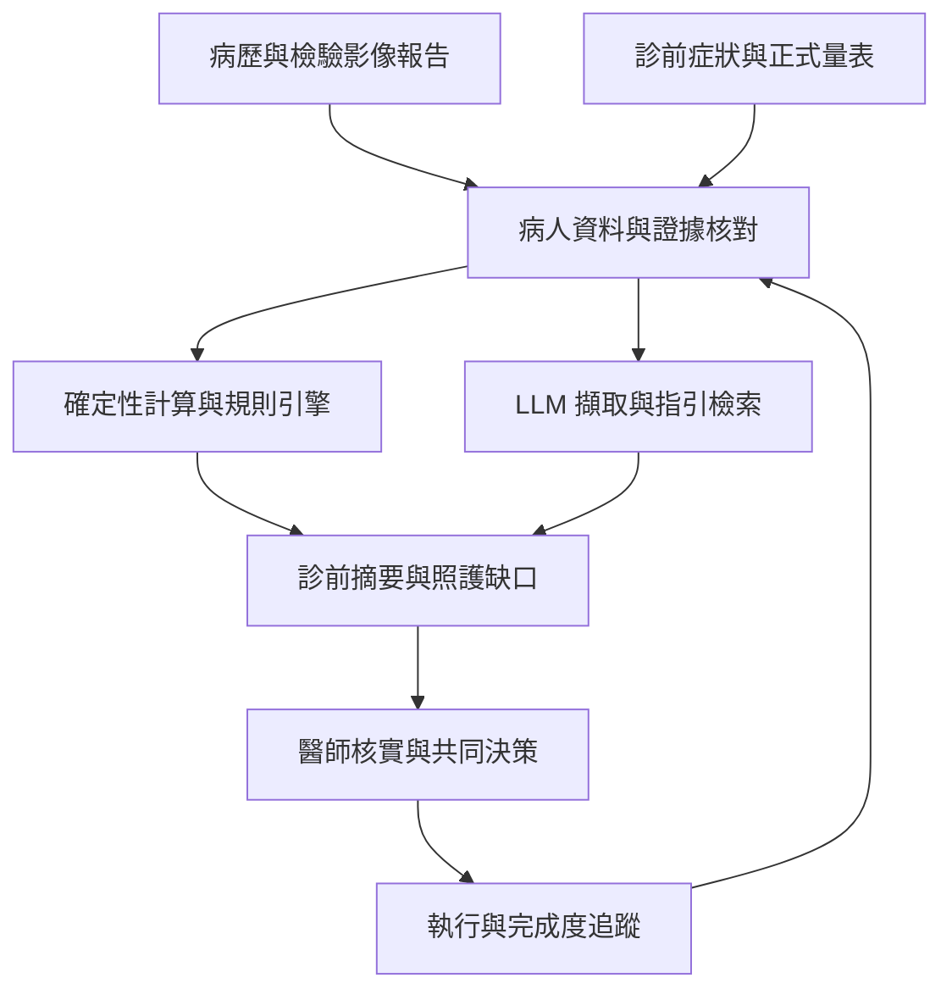

# AI 如何支援跨專業照護流程

**AI agent 的工作應以可追溯的臨床資料為中心。** 建議將流程拆成資料、計算、判斷與溝通四種責任。原始資料中的患者身分、日期、單位、檢查狀態及來源必須先核對；語言模型負責從敘述中擷取線索、解釋與整理，確定性的程式負責公式、量表加總及明確規則，醫師負責臨床確認與處方決策。

| 工作 | 建議執行方式 | 交付內容 |
| --- | --- | --- |
| 診前病歷整合 | 院內核准的資料介接，整理病史、有效藥單、檢驗與專科報告。 | 每項附來源、日期與缺漏原因的時間序列。 |
| 病人需求與生活評估 | 簡短症狀及生活問題，必要時接正式量表；提供人員訪談替代數位填答。 | 病人最想解決的問題、飲食與用藥障礙、實際回答與未回答項目。 |
| 計算與分層 | 由版本固定、可測試的 calculator／風險模型執行。 | 數值、適用族群、輸入日期、單位與無法計算原因。 |
| 指引與治療檢核 | 規則引擎結合版本化指引檢索，分開核對台灣給付規則。 | 有理由的治療評估提示；保留禁忌、耐受性與病人偏好。 |
| 診間摘要與紀錄 | LLM 產生摘要草稿，由人員確認重要事實與計畫。 | 今日優先問題、衝突資訊、醫師與病人共同決定的行動。 |
| 跨專業協作 | 共用問題清單，分配給個管、營養、藥事、心理／社工及專科。 | 責任人、時程、待處理原因及完成證據。 |
| 診後衛教與追蹤 | 根據已核定計畫產生易懂說明，追蹤檢查、轉介及困難是否改善。 | 病人版待辦、待聯繫清單、需提早回報給人員的問題。 |
| 品質與行政 | 從真實服務紀錄整理登錄草稿與缺件。 | 區分「已做」「已記錄」「已上傳」；不把空白欄位自動填成完成。 |

FHIR 可作為資料交換方式，CDS Hooks 可在開啟病歷等工作流程節點呼叫決策支援；院內是否支援及如何對應，仍由資訊系統實際能力決定。[HL7 CDS Hooks](https://cds-hooks.hl7.org/)

下圖是建議的資料與決策流程；同一病人的紀錄、問卷與檢查結果匯入共同狀態，再由不同工具產生可覆核的結果。

第一版可使用一個主控 agent 呼叫多個受控工具；是否拆成多個 agent，應依模組責任、可測試性與維護需要決定。增加 agent 數量本身不代表臨床正確性提高。

**計算機必須回答明確的臨床問題。** 目前疾病分期、篩檢結果與未來事件機率，應分開呈現。

| 工具 | 回答的問題 | 使用界線 |
| --- | --- | --- |
| CKD G／A 分類 | 現有腎功能與白蛋白尿落在哪個分層？ | 慢性及病因需另行確認；分期不是透析機率。 |
| FIB-4 | 是否需要進一步評估進展期肝纖維化？ | 不是直接肝硬度，也不是未來肝硬化的百分比。 |
| BNP／NT-proBNP、ABI／TBI | 是否有需進一步評估的心臟或下肢血管異常？ | 結果受情境與測量限制影響。 |
| IWGDF 足部風險 | 應安排多密集的預防與追蹤？ | 依足部檢查分層，0／1／2／3 級分別約每年／6–12 月／3–6 月／1–3 月追蹤；缺檢查不可預設 0 級。[IWGDF](https://iwgdfguidelines.org/wp-content/uploads/2023/07/IWGDF-Guidelines-2023.pdf) |
| PREVENT | 無已知 CVD 的適用成人，其未來 CVD／ASCVD／HF 風險？ | 10 年估計適用 30–79 歲；30 年估計適用 30–59 歲。已有 CVD 不套用其初級預防估計。[AHA](https://professional.heart.org/en/guidelines-and-statements/prevent-calculator) |
| WATCH-DM | 第 2 型糖尿病、無既往 HF 者的 5 年新發 HF 住院風險？ | 應採已發表的指定版本與輸入，並檢查外部適用性。[原始研究](https://pubmed.ncbi.nlm.nih.gov/31519694/) |
| KFRE | CKD G3–G5 病人的 2／5 年腎衰竭風險？ | 不泛用於所有糖尿病或 G1–G2；端點及模型版本需標明。[KDIGO](https://doi.org/10.1016/j.kint.2023.10.016) |
| Karter 低血糖工具 | 第 2 型糖尿病未來 12 個月因低血糖急診／住院的風險？ | 不等同所有輕微低血糖的發生率。[原始研究](https://jamanetwork.com/journals/jamainternalmedicine/fullarticle/2649265) |

每次輸出至少記錄工具名稱、版本、適用條件、端點、時間範圍、輸入與資料日期。數值由程式計算，缺資料時顯示無法估計。台灣資料的校準與外部驗證，應與「是否正確實作原始公式」分別評估；既有外部驗證不等於已在院內驗證。

版本管理已有具體例子：AHA 在 **2026 年 10 月 14 日**修正 PREVENT 含 HbA1c 的附加及完整公式；基本模型與僅使用其他可選變項的公式未受影響。若未來接上 PREVENT，應核對此更新並保留舊版結果的來源，避免不同版本數值混在同一趨勢中。[AHA 更新說明](https://professional.heart.org/-/media/PHD-Files/Guidelines-and-Statements/PREVENT/PREVENT-Update-FAQ-101426.pdf)

疾病、風險與缺口也應分成不同欄位，允許同時存在。例如一位病人可以「已確診 CKD」「腎衰竭風險待估」且「UACR 追蹤逾期」。建議保留疾病狀態、風險結果、資料完整度與行動狀態四個面向。未檢查、未匯入、外院已做、影像不可判讀、病人暫緩，代表不同情況；沒有紀錄不能自動變成陰性或照護失敗。

