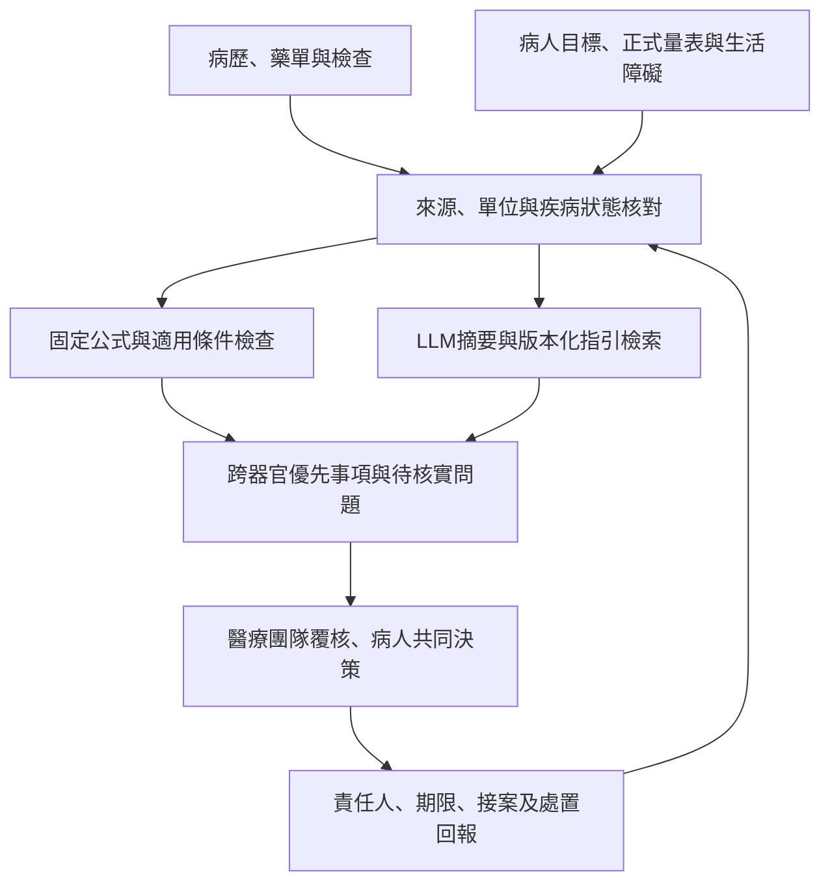

# 糖尿病併發症與全人整合照護：新增證據與落地架構

查核日期：2026-11-11，Asia/Taipei。以英文檢索 PubMed 索引、PMC、原始期刊與官方指引；這是針對臨床問題的主題式證據綜整，未完成全面去重、雙人篩選及正式 risk-of-bias 表，不能稱 systematic review。既有第 1–11 章保留；本章補強原稿的療效界線、心理介入及 AI 可驗證用途。完整檢索規格見 [SEARCH_PROTOCOL](../research/SEARCH_PROTOCOL_20261111.md)，來源與效應值見 [evidence matrix](../sources/evidence_matrix_20261111.csv)。

## 1. 核心結論

糖尿病整合照護的單位應是「病人及其照護問題」，而非單一 HbA1c 或每科各自的疾病。最重要的工作是共同確認疾病與優先目標、減少衝突處方和治療負擔、完成必要篩檢，並把異常接到評估、治療和再追蹤。心理健康、日常功能與病人的可執行能力需要一起進入照護計畫。

多重風險因子介入已有部分長期器官及死亡結局支持，但效果受族群、原有照護水準、介入強度與持續性影響。科技輔助個管與結構化評估有達標或流程效益；不能據此說 generative AI／agent 已證明能降低所有併發症。

## 2. 目前困難及需要整合的內容

| 困難 | 臨床後果 | 需要整合的資料與工作 | AI 可測試的協助方式（設計推論） |
| --- | --- | --- | --- |
| 單病種照護與資料分散 | 每科目標合理但整體負擔過大；重複檢查或漏看報告 | 同一份 problem list、有效藥單、病人目標、專科結論與責任人 | 抽取日期及來源，標示衝突與待核實項目 |
| Clinical inertia 與時間不足 | 該處理的風險長期未被回應 | 區分漏處理與合理暫緩：禁忌、低血糖、費用、偏好 | 提醒有證據的缺口，允許醫師填寫不處理理由 |
| 完成篩檢卻沒完成處置 | 有眼底 AI 結果但未看眼科；有蛋白尿但無後續評估 | 檢查→異常確認→轉介→到診→治療→回傳結論 | 建立未結案清單，不把開立轉介當成完成 |
| 多器官疾病與多重用藥 | 腎功能、K、容量、低血糖、營養與功能風險互相影響 | CKD/HF/ASCVD、frailty、用藥耐受性與實際服法 | 規則型安全檢核；LLM 解釋衝突及產生供覆核的摘要 |
| 心理與療程負擔未被看見 | 情緒壓力被誤認為不配合；增加療程反而更難執行 | Distress、depression、anxiety、低血糖恐懼、支持與交通經濟 | 保留病人原意，連到個管、心理、社工及療程簡化 |
| 健康識能與數位落差 | 不會用設備、無法填表或沒有網路者被排除 | Teach-back、語言、視聽覺、操作與照顧能力 | 提供簡明語言及人員協助替代路徑 |
| 團隊責任與資源不足 | 報告增加卻沒有人執行；alert fatigue | 個管工時、接案量、回覆時限、備援與跨科共用流程 | 只將可處理且有責任人的項目轉為任務 |

以上整理與整合照護實施研究及 ADA person-centered interprofessional care 一致；不同機制對結局的獨立效應仍不易分離。[Busetto implementation review](https://pubmed.ncbi.nlm.nih.gov/26772769/)、[ADA 2026 Section 4](https://pubmed.ncbi.nlm.nih.gov/41358897/)。

## 3. 整合照護的臨床證據：同時保留陽性與陰性結果

| 研究 | 族群及介入 | 主要結果 | 解讀與限制 |
| --- | --- | --- | --- |
| Steno-2，2003；160 人 | T2D＋microalbuminuria，多重風險因子介入，7.8 年 | CVD HR 0.47（95% CI 0.24–0.73）；nephropathy HR 0.39、retinopathy HR 0.42 | 支持高風險族群綜合處理，不能推估每個單一組件或 AI 的效益。[PMID12556541](https://pubmed.ncbi.nlm.nih.gov/12556541/) |
| Steno-2，21 年延伸追蹤 | 依原始隨機組追蹤；7.8 年後兩組皆採密集治療 | 死亡 HR 0.55（0.36–0.83），median survival 增加 7.9 年 | 不能寫成持續 21 年的隨機差異介入。[PMID27531506](https://pubmed.ncbi.nlm.nih.gov/27531506/) |
| ADDITION-Europe | 3,057 名篩檢發現 T2D；基層團隊多重因子處理 | 5 年 CVD HR 0.83（0.65–1.05）；10 年 HR 0.87（0.73–1.04） | 均未達顯著，不能只選 Steno-2 推論所有病人皆有同等效益。[5年](https://pubmed.ncbi.nlm.nih.gov/21705063/)、[10年](https://pubmed.ncbi.nlm.nih.gov/31748169/) |
| J-DOIT3 | 2,542 名日本 T2D，median 8.5 年 | 主要複合終點 HR 0.81（0.63–1.04），p=0.094 | 非嚴重低血糖 41% vs22%；更密集不必然等於更適當。[PMID29079252](https://pubmed.ncbi.nlm.nih.gov/29079252/) |
| CARRS，2016 | 1,146 名控制不佳 T2D，care coordinator＋EHR CDS | 多重目標達成 RR 2.24（1.71–2.92）；HbA1c 組間差約−0.50 percentage points | 組合式介入，不能單獨歸因軟體；不是 LLM。[PMID27398874](https://pubmed.ncbi.nlm.nih.gov/27398874/) |
| CARRS，6.5 年延伸分析 | 原隨機組 post-hoc follow-up | Micro/macrovascular 首發複合 HR 0.72（0.61–0.86）；microvascular HR 0.68（0.56–0.83） | Macrovascular 無明確差異；效益見於持續介入站點。後續追蹤與介入持續性須交代。[PMID38829880](https://pubmed.ncbi.nlm.nih.gov/38829880/) |
| JADE，2021 | 20,834 人、8 國50中心；結構化評估、個人報告、護理聯繫 | 12 個月多重心代謝目標改善，臨床事件未顯著減少 | 短期達標與事件效益須分開。[PMID33929522](https://pubmed.ncbi.nlm.nih.gov/33929522/) |
| JADE-DKD，2022 | 2,393 名 DKD，結構化回饋與 team-based empowered care | 支持多重治療目標改善 | 達標者事件較少的關聯，不是隨機組間硬終點因果效益。[PMID35333363](https://pubmed.ncbi.nlm.nih.gov/35333363/) |
| Taiwan P4P，2016／2020 | 配對健保資料世代 | 死亡 HR 0.76／aHR0.58 | 觀察關聯仍有選案、健康參與者及殘餘混雜。[2016](https://pubmed.ncbi.nlm.nih.gov/27399144/)、[2020](https://pubmed.ncbi.nlm.nih.gov/32049836/) |
| Integrated diabetes–kidney service | 196 介入 vs7,511 standard care，非隨機 | 住院 IRR **1.20**，LOS較短、死亡IRR較低 | **不能寫成降低住院**；對照資料不足以充分風險調整。[PMID34314493](https://pubmed.ncbi.nlm.nih.gov/34314493/) |

綜合證據也不能混用設計：Lim 等納入181 trials，HbA1c平均差−0.28 percentage points；Zarora 等 RCT 平均差約−0.10，而 pre-post 為−0.77，兩者不可互換。[Lim2018](https://pubmed.ncbi.nlm.nih.gov/29784698/)、[Zarora2022](https://pubmed.ncbi.nlm.nih.gov/35634254/)。足部 multidisciplinary team 回顧33篇中31篇報告 major amputation 減少，但沒有RCT；「94%研究報告改善」**不是截肢風險降低94%**。[PMID31676181](https://pubmed.ncbi.nlm.nih.gov/31676181/)。

## 4. 併發症如何跨器官整合

下表為依已核實指引與研究形成的實作提案；不是新量表、藥物處方或額外試驗結果。疾病已確診、疑似異常、未來風險及待辦事項要分欄。

| 領域 | 必須同時掌握 | 異常後的整合行動 | 完成證據 |
| --- | --- | --- | --- |
| Kidney | eGFR＋UACR趨勢、持續性、K、血壓、容量、藥物 | 核實 CKD 及其他腎病可能；評估適合的 ACEi/ARB、SGLT2i、finerenone、GLP-1RA 等器官保護策略與轉介 | 複驗、適用性/未用理由、監測及腎科結論 |
| Heart/vascular | ASCVD、HF症狀、EF/結構、BP、lipids、smoking、PAD | 依已確診疾病處理，協調容量/腎功能/低血糖與藥物；急性症狀不等待風險分數 | 診斷、治療及追蹤計畫；無ASCVD者才選適用初級預防模型 |
| Liver | MASLD風險、FIB-4、肝酵素、platelets、飲酒與其他病因 | 合適時接 VCTE/ELF或 hepatology；ALT正常不能排除 fibrosis | 第二線檢查與專科判讀，非只有FIB-4數字 |
| Eye | DR分級、黃斑部問題、影像品質、視力症狀、眼科處置 | AI abnormal/ungradable接眼科；視力急變依症狀優先評估 | 到診、病變確認、處置與下次追蹤日期 |
| Foot/nerve/PAD | 保護性感覺、脈搏、變形、既往潰瘍/截肢、腎衰竭 | IWGDF分層連接足部照護；潰瘍整合 infection、perfusion、offloading與wound care | 足部檢查及分期、轉介/處置；不是僅填有無足病 |
| Function/safety | 嚴重低血糖、跌倒、認知、frailty、視聽與用藥能力 | 調整個別目標、簡化療程，協調家屬/照護與營養 | 可執行計畫與teach-back、低血糖處理能力 |
| Psychosocial | Distress、depression/anxiety、恐懼、工作/交通/費用、病人優先目標 | 對應病人問題而非一律加衛教；必要時心理/精神/社工及藥物評估 | 人工評估、接受/暫緩理由、後續接案與量表/功能變化 |

藥物是否適用、台灣核准與健保給付需分別核對；不能把國際指引適應性直接當給付資格。原有第4–5章提供指引與轉介細節。

## 5. 心理整合不是附加一個 chatbot

Diabetes distress 是與疾病及自我管理相關的情緒負擔，與 depression 或 anxiety 有重疊但不同；PHQ-9低分不能排除高度糖尿病困擾。情緒狀況也不是「依從性差」的代稱。至少應在常規回顧及發生併發症、治療變動、轉銜、未達目標等情況重新評估。[ADA2026 Section5](https://pubmed.ncbi.nlm.nih.gov/41358898/)。

2026 EASD diabetes distress guideline 已於**2026-09-15線上發表**，紙本卷期為2026 Dec。它支持例行情緒對話、validated instruments、共同照護計畫、紀錄及可取得的心理支援。T1D的心理介入及CGM/AID、T2D的心理/心理教育/教育介入為 conditional recommendations；不宜改寫成所有心理介入皆有高確定性效果。[PMID42744915](https://pubmed.ncbi.nlm.nih.gov/42744915/)。

| 研究 | 對整合心理照護的支持 | 限制 |
| --- | --- | --- |
| TEAMcare，214人RCT | Nurse care manager與醫師共同處理depression及diabetes/CHD，12個月多指標與情緒改善 | 非AI試驗，未證實減少失明或透析。[PMID21190455](https://pubmed.ncbi.nlm.nih.gov/21190455/) |
| INDEPENDENT，404人RCT | 個管、EHR CDS與專家case review；24個月主要複合結果改善 | Table2為71.6%vs54.7%，RD16.9pp；abstract印57.4%，**來源內部不一致需保留**。Severe hypoglycemia8人vs0；不能稱全部心代謝指標皆改善。[JAMA Table2](https://jamanetwork.com/journals/jama/fullarticle/2769466) |
| REDEEM，392名T2D | Distress與部分自我照護改善，支持針對具體困擾 | 整體組間差異不顯著、HbA1c未改善。[PMID23735726](https://pubmed.ncbi.nlm.nih.gov/23735726/) |
| T1-REDEEM，301名T1D | Emotion-focused及education/behavioral介入皆改善distress | 無usual-care對照；情緒變化與HbA1c關聯弱，心理照護有其獨立價值。[PMID29976567](https://pubmed.ncbi.nlm.nih.gov/29976567/) |

實作上，先邀請病人說出最困擾的部分，再選擇 PHQ-9/GAD-7、DDS/PAID 或 WHO-5 等適用量表；篩檢陽性連到真人評估與可提供的服務。PHQ-9第9題陽性需即時人工評估，不能因總分低而自動略過；量表不得由LLM代答。減少注射/監測負擔、協調工作時段或處理交通費用，有時比新增衛教訊息更直接，但須以個別情境確認。

## 6. AI 的證據到底支持到哪一層

| 證據層次 | 已有例子與結果 | 可以說什麼 | 尚不能說什麼 |
| --- | --- | --- | --- |
| Diagnostic accuracy | Autonomous DR pivotal study，900人，sensitivity87.2%、specificity90.7% | 特定設備/族群/影像任務的診斷效能 | 全器官照護有效或降低失明。[PMID31304320](https://pubmed.ncbi.nlm.nih.gov/31304320/) |
| Care process | ACCESS，164名8–21歲T1D/T2D，眼底檢查完成100%vs22%；異常者16/25完成後續眼科 | 在該場域大幅改善篩檢完成 | 失明下降；仍有36%異常者未完成追蹤。[PMID38212308](https://pubmed.ncbi.nlm.nih.gov/38212308/) |
| Intermediate outcomes | Voice-based basal insulin AI，32人8週，達optimal dose中位15vs>56天 | 受控、短期titration流程的潛力 | 開放式LLM可自由處方或長期安全。[PMID38039007](https://pubmed.ncbi.nlm.nih.gov/38039007/) |
| Intermediate outcomes | iNCDSS，149名住院T2D，5天，TIR76.4%vs73.6%，符合預設noninferiority | 選定病房與族群的短期非劣性 | ICU、steroid、nutrition support等未納入情境可直接泛用。[PMID40332936](https://pubmed.ncbi.nlm.nih.gov/40332936/) |
| Retrospective/vignette LLM evaluation | GPT-4複雜T2D243份notes；2026 RAG-CGM12cases、288responses | 可研究摘要、解說與診前準備；也顯示脈絡錯誤 | 專家評分高即臨床優於醫師，或能減少器官事件。[GPT4](https://pubmed.ncbi.nlm.nih.gov/41140742/)、[RAG-CGM](https://pubmed.ncbi.nlm.nih.gov/42544991/) |
| Patient-important outcomes | Steno-2、CARRS長期追蹤支持部分整合照護效益 | 多重風險管理、個管與持續介入有重要作用 | 將這些傳統介入的硬終點效益歸因generative AI |

## 7. 建議的 AI 整合架構

這是依據上述證據提出的設計方案，未宣稱已部署或驗證。

第一層資料核對須保留否定、家族史、時間和不確定性，例如「家人透析」不能寫成病人ESKD。第二層 calculator 由固定程式計算；LLM可協助選出待補資料，不負責臨時計算或創造係數。第三層 guideline/RAG 回覆附版本及段落，保留禁忌、治療負擔和個人偏好。第四層把**已核定**計畫轉成團隊任務，每項有負責人、完成證據與重評時間。

輸出一頁式摘要可用：病人最在意的1–2件事；今天安全問題；已確診器官病；需確認異常；適用模型的風險；心理與社會問題；本次共同決定的行動。緊急症狀依臨床處置，不因分數低而延後。

## 8. 可執行研究設計

1. **資料與離線驗證**：使用適當核准資料，建立醫師確認的problem list、藥單與照護缺口標準。量測entity/negation/date/unit錯誤、漏抓重大問題、無依據建議，按CKD、年齡、性別、語言與數位能力分層。
2. **Silent prospective evaluation**：不影響處置，檢查預測校準、工具適用性與alert負擔；以同一輸入核對原始公式輸出，區分數學正確與臨床外部驗證。
3. **團隊流程試辦**：先接腎臟、眼底與心理三條路徑，評估異常後在預定時限內完成人工評估/轉介/處置的比例；時限由院內流程和臨床急迫性預先定義，不能事後調整達標標準。
4. **Cluster RCT或step-wedge比較**：AI＋既有團隊 vs既有團隊，避免把增加人力全部當AI效果。主要終點可選預先指定的照護缺口完成率；次要為時間、負擔、distress、HbA1c、低血糖及病人滿意度。住院、eGFR slope、視力、截肢、死亡需足夠樣本與較長追蹤。

| 評估面向 | 指標例子 | 必須避免 |
| --- | --- | --- |
| 疾病偵測 | 醫師確認的重要共病/缺口之precision、recall | 只看流暢度或文字相似度 |
| 完成照護 | 異常後到診、治療、回報的分子與分母 | 只計算轉介單開立數 |
| 病人與團隊負擔 | Patient-reported burden、distress、診前/紀錄/個管工時 | 只減少醫師打字卻增加其他人工作 |
| 安全性 | 嚴重低血糖、錯誤用藥提示、延遲處理、無依據診斷 | 假設有醫師覆核就零風險 |
| 公平性 | 語言、數位能力、年齡、CKD與社會資源分層 | 將無法填問卷者排除卻不報告 |
| 長期效益 | 器官結局、hospitalization、QoL、費用 | 將流程或AUC當作硬終點替代證據 |

較合適的研究主張是：**AI是否能在既有跨專業團隊中，使多器官與心理照護更完整、及時且可持續，同時降低病人與團隊負擔？** 其效益需要由流程到病人結局逐層證明。
