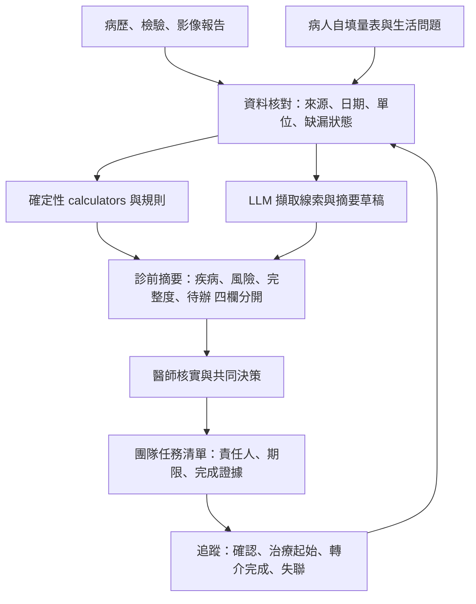

# AI 整合糖尿病照護：全文驗證後的整合報告

查核日期：2026-11-11（Asia/Taipei）。本章是四個獨立研究 sessions（complications、psychosocial、calculators、methods_ai）的整合稿，回答六個研究問題。

**這是目的式文獻綜整，不是 systematic review**：沒有雙人獨立篩選、沒有正式 RoB 2／PROBAST 評讀、沒有自行合併的效果量。所有數字都是原文數字。內容用於專業討論與系統設計，不是已部署的臨床系統，也不能取代個別病人的臨床判斷。

## 如何閱讀

| 標記 | 意義 |
| --- | --- |
| 📄 | 已取得本地全文，數字用 `grep` 在全文中找到 |
| 📌 | 只有 abstract 或 metadata，不做超出 abstract 的斷言 |
| `UNRESOLVED` | 本輪無法確認，沒有用推論補洞 |
| 設計推論 | 依證據提出的做法，本身沒有結局證據 |

每個數字的逐篇來源在各 session 的報告與證據表：
[complications](../sessions/complications/report.md)、[psychosocial](../sessions/psychosocial/report.md)、[calculators](../sessions/calculators/report.md)、[methods_ai](../sessions/methods_ai/report.md)。跨 session 的互相查核在各自的 `crosscheck.md`。

## 本輪執行紀錄

| Session | 證據表筆數 | 其中有本地全文 | 交付 |
| --- | ---: | ---: | --- |
| complications | 51 | 35（含 3 篇經 Sci-Hub 取得） | 報告、證據表、檢索紀錄、交接、交叉查核 |
| psychosocial | 57 | 38 | 同上 |
| methods_ai | 23 | 21 | 同上 |
| calculators | 35 | 以官方文件與開放全文為主 | 同上，加 `calculators/` 程式與 102 個測試 |

全文與解析檔在 `literature/fulltext/`、`literature/parsed/`，因版權不進 git；`literature/receipts/` 保存雜湊與任務編號。Steno-2 兩篇（2003、2008）取不到全文，維持只有 abstract。

## 1. 先講結論

1. **最硬的困難點是流程斷點，不是不知道指引。** 該做的檢查沒做、異常沒確認、該用的藥沒開、轉介沒完成，每一段都有大比例流失（第 2 節）。
2. **整合照護對達標率的效果一致但幅度不大，對硬終點的證據少而且有條件。** Steno-2 正向；ADDITION-Europe、J-DOIT3、JADE 的事件結果是中性；CARRS 長期追蹤只在繼續實施的站點看到微血管事件下降（第 5 節）。
3. **「產生報告」本身沒有效，要有人負責解讀和行動。** JADE-DKD 中只給個人報告與電話提醒的組別相對 usual care 沒有好處（RR 0.95，0.80–1.12），加上固定的醫師護理團隊才有效（RR 1.20，1.03–1.40）📄。
4. **心理層面要分成四個構念**：diabetes distress、depression、anxiety、fear of hypoglycemia。降低 distress 不等於降低 HbA1c；HbA1c 改善主要出現在團隊同時調藥的 collaborative care（第 6 節）。
5. **沒有任何心理介入或 AI 介入的試驗，以失明、腎衰竭、截肢、心血管事件或死亡為主要結局**（本輪定向檢索未找到，不能證明不存在）。
6. **AI 的證據越接近病人結局越薄。** 眼底影像 AI 的診斷準確度與篩檢完成率有前瞻或隨機證據；血糖類指標只有小型短期試驗；LLM 在糖尿病的研究幾乎都是離線評估（第 7 節）。
7. **AI 可以提高篩檢完成率，但下游仍會流失。** ACCESS 試驗中 AI 組眼底檢查完成 100%，但 AI 判陽性的 25 人只有 16 人（64%）完成眼科追蹤 📄。
8. **Calculator 要回答明確的單一問題，缺值就回報無法計算。** 多數 CKD 病人沒有 UACR，風險公式常常算不出來；傳統風險方程式在台灣族群需要重新校準（第 8 節）。
9. **不合成「全人風險總分」。** 目前疾病、預測風險、資料完整度、行動完成度是四種不同的資訊，要分開呈現。
10. **台灣觀察研究（P4P）的死亡風險下降幅度遠大於隨機試驗，且有依從度梯度，強烈提示 healthy-adherer 偏誤，不能當成因果證據** 📄。

## 2. 困難點在哪裡

### 2.1 流程斷點（有量化資料）

| 斷點 | 量化證據 | 判讀界線 |
| --- | --- | --- |
| UACR 沒有做 | CKD 病人 59% 沒有 albuminuria 檢測 📄 [PMID 36434513]；30 項研究合併的檢測率，固定效應約 22%、隨機效應 49%（95% CI 7–93%）📄 [41345917] | 異質性接近 100%，單一數字沒有意義；有制度化方案的地方接近 100% |
| 異常後沒有確認與處理 | 新發現 albuminuria 的 215,035 人：1 年內重測 46%，符合條件者轉腎臟科 28%，RASi／SGLT2i 起始率依嚴重度為 10%／12%／37% 📄 [41360255] | 單一區域（Stockholm），含非糖尿病者 |
| 器官保護藥物使用不足 | 英國基層 980 萬成人：符合 NICE 條件者 17.5% 使用 SGLT2i，只有 CKD 者 3.8% 📄 [42723263]；美國 VA 的 T2D＋CKD＋ASCVD：2020 年 11.5%，女性較低（OR 0.59）📄 [36702340] | 「符合條件」由演算法界定，禁忌與不耐受未必看得到；不同年份不能直接比 |
| 眼底照護一路流失 | 美國 46 項研究的中位數：兩年內篩檢 59.4%；確診後首次接上治療 52.0%；追蹤中斷 70.3% 📄 [42270111] | 只限美國；各段來自不同研究 |
| Clinical inertia | 25 項研究、575,067 人，多數研究超過一半的病人有治療延遲 📄 [36676805]；英國 CPRD：HbA1c ≥7% 且延遲 1 年強化者，心血管事件 HR 1.62（1.46–1.80）📄 [26249018] | 定義不一；CPRD 是觀察性研究 |

**各段來自不同族群與制度，不能串成單一漏斗機率。**

### 2.2 照護分散與多重共病

- 照護連續性高，和較少住院、死亡與併發症相關，但和血壓、血脂的關聯很弱；研究多為計票式整理，因果未定 📄 [34217212]。
- T2D 合併其他慢性病的比例 83.17%（I² 97.0%），但定義把高血壓等常見併存都算入，不宜解讀成「83% 有第二個需要獨立處置的疾病」📄 [41382017]。
- 治療負擔可以量測（PETS、TBQ、MTBQ 的評價較好），但沒有證據顯示依負擔調整治療能改善結局 📄 [38858619]。`UNRESOLVED`
- 社會因素對不同品質指標的方向不同，不能用單一「品質」概括 📌 [32720345]。
- 「門診時間限制」與 health literacy 對上述斷點貢獻多少，本輪沒有找到可核對的直接研究。`UNRESOLVED`

### 2.3 心理層面的困難

- 四個構念彼此重疊，單一量表陽性不能換算成另一個診斷 📄（ADA 2026 第 5 章）。
- 盛行率依量表與切點差異很大：diabetes distress 在 ADA 的敘述是 T2D 超過 60%，Perrin 2017 的統合分析是 36% 📌。兩個數字要並列並註明切點，不能只挑一個。
- 台灣成人 T2D 的 diabetes distress、anxiety、fear of hypoglycemia、認知障礙盛行率，本輪英文檢索沒有找到。`UNRESOLVED`

## 3. 需要整合哪些東西

| 整合層 | 具體內容 | 有直接支持的證據 | 界線 |
| --- | --- | --- | --- |
| 資料 | HbA1c、BP、LDL、eGFR、UACR、眼、足的結構化評估；registry；每項附來源與日期 | JADE 的結構化評估與分層 📄 [33929522] | JADE 對照組也做評估，「評估」的獨立效果沒有被分離出來 |
| 人員 | 非醫師照護協調員或個管師、固定的醫師護理團隊、專科個案討論、足部多專科團隊 | CARRS 📄 [27398874]；JADE-DKD 📄 [35333363]；TEAMcare 📄 [21190455]；足部團隊含 podiatry 的總截肢 RR 0.69（0.54–0.89）📄 [32192509] | 協調員與軟體是綑綁介入，無法個別歸因；足部團隊研究多為觀察性 |
| 決策 | treat-to-target、決策支援、處方調整提示、專科回饋 | TEAMcare、CARRS | 目標更嚴不等於更好：J-DOIT3 主要終點未達顯著，非嚴重低血糖 41% 比 22% 📌 [29079252] |
| 追蹤迴圈 | 異常確認、治療起始、轉介完成、失聯追蹤 | ACCESS 📄 [38212308]；SCREAM 顯示現況斷點 📄 [41360255] | 沒有找到成人 T2D 的隨機試驗以「轉介完成或治療起始」為主要結局 `UNRESOLVED` |
| 心理與社會 | 四個心理構念的篩檢、鑑別、介入與再評估；社會需求 | TEAMcare、INDEPENDENT；EASD 2026 diabetes distress 指引 📄 | 指引的建議多為條件式、證據確定性低 |

依器官看，直接的整合介入證據集中在腎臟、眼底與足部。心衰竭、PAD、認知與 frailty 本輪沒有找到糖尿病專屬的整合介入隨機證據。`UNRESOLVED`
MASLD 方面，FIB-4 接 elastography 的路徑估計會把約 40% 的 T2D 病人導向 transient elastography、約 20% 導向三級照護 📄 [38334817]，全面篩檢若沒有分流容量會變成轉介過載。

## 4. 如何更完整評估共病

評估分五個面向並列，不加總：

| 面向 | 工具或做法 | 回答什麼 | 缺口 |
| --- | --- | --- | --- |
| 器官狀態 | eGFR＋UACR（CKD G/A）、眼底、足部（IWGDF 分層）、FIB-4、BNP／NT-proBNP、ABI | 現在有沒有異常、落在哪一層 | 單次異常不等於確診；各項有測量限制 |
| 共病負擔 | aDCSI、Charlson | 已存在的併發症與一般共病有多重 | 只用診斷碼、以死亡校準、不含檢驗值、心理、功能與社會因素 |
| 未來事件風險 | KFRE、SCORE2-Diabetes、PREVENT、WATCH-DM 等 | 指定族群在指定時間內發生指定事件的機率 | 需要外部校準；台灣驗證有限 |
| 心理 | PHQ-9、GAD-7、DDS-17 或 PAID、WHO-5、HFS-II | 當下的症狀、困擾或幸福感 | 必須本人作答；陽性是篩檢結果，不是診斷 |
| 功能與生活 | 認知、frailty、治療負擔、社會需求 | 病人做不做得到 | 台灣工具與切點多未驗證 |

台灣健保資料 1,002,589 人的研究顯示，aDCSI 與 Charlson 捕捉的面向不同：aDCSI 對全因死亡的 HR 1.21，對癌症死亡只有 1.04 📄 [36977521]。單一分數不能取代分項。

**每個評估項目要記錄完成狀態**（已完成、未做、不明、病人暫緩、外院已做），把「未完成」當成可以追蹤的狀態，而不是 0 分。這是依第 2 節的斷點資料提出的設計推論，目前沒有研究驗證這種完整度指標能改善結局。

ADA Standards of Care 2026 第 4 章（comprehensive medical evaluation）全文不在 PMC 開放子集，本輪沒有複述其建議內容。`UNRESOLVED`

## 5. 併發症整合照護的實證

三層終點分開看：

| 層級 | 證據 | 一句話 |
| --- | --- | --- |
| 篩檢與流程完成 | UACR、眼底流失資料；ACCESS（青少年）100% 比 22% 📄 | 完成篩檢不等於接受治療 |
| 代理指標 | CARRS 多重目標達成 18.2% 比 8.1%（RR 2.24，1.71–2.92）📄；JADE-DKD 📄；TEAMcare 📄；Cochrane 553 項 RCT 的效果為 modest，確定性多為低或很低，平均追蹤 12.5 個月 📄 [37254718] | 一致但幅度不大（HbA1c 約降 0.3–0.6 個百分點） |
| 硬終點 | 見下表 | 需要高風險族群、持續介入與夠長的追蹤 |

| 試驗 | 族群與人數 | 追蹤 | 硬終點結果 | 要保留的限制 |
| --- | --- | --- | --- | --- |
| Steno-2 📌／📄 | T2D＋微量白蛋白尿，160 人 | 7.8 年／21.2 年 | 心血管事件 HR 0.47（0.24–0.73）📌；21 年死亡 HR 0.55（0.36–0.83）📄 [27531506] | 小樣本、高強度專科介入；7.8 年後兩組都強化治療 |
| ADDITION-Europe 📄 | 篩檢發現的 T2D，3,057 人 | 5.3 年 | 心血管事件 HR 0.83（0.65–1.05），未達顯著 [21705063] | 兩組危險因子差距小 |
| J-DOIT3 📌 | 2,542 人 | 8.5 年 | 主要複合終點 HR 0.81（0.63–1.04）[29079252] | 非嚴重低血糖 41% 比 22% |
| JADE 📄 | 20,834 人，亞洲 8 國含台灣 | 12 個月 | 事件 OR 0.94（0.74–1.21）與 1.02（0.83–1.25）[33929522] | 12 個月再評估完成率偏低 |
| CARRS 長期 📄 | 1,146 人中 854 人有資料 | 6.5 年 | 微血管事件 HR 0.68（0.56–0.83）；大血管無差異；只在繼續實施的站點有效 [38829880] | post hoc 分析；25.5% 缺資料 |
| 台灣 P4P 📄 | 配對世代 5,478 對 | 約 4 年 | 死亡 aHR 0.58（0.48–0.69）[32049836] | 觀察性；依從 1 年以上 0.48、2 年以上 0.36，提示 healthy-adherer |

Cochrane 的排序中，case management、team changes、patient education、promotion of self-management 在多數結局屬於效果較好的元件 📄。

## 6. 心理層面的整合照護

### 6.1 從篩檢到再評估

| 步驟 | 指引要點（ADA 2026 第 5 章、EASD 2026）📄 | AI 或系統可以做 | 不可以做 |
| --- | --- | --- | --- |
| 篩檢 | 至少每年一次；出現併發症、換治療或生活重大變動時重篩 | 依病歷事件提醒、推送量表、追蹤未完成 | 代填答案；把沒有紀錄當成陰性 |
| 對話 | 每次門診談情緒面，用開放式問題 | 提供提問範例 | 取代對話 |
| 臨床評估 | 陽性後由合格專業人員鑑別 distress、憂鬱、焦慮 | 整理分數趨勢、既往診斷與用藥 | 下診斷 |
| 個別化照護 | distress：DSMES、CBT 等；共病憂鬱：collaborative care | 排個案討論名單、提醒未達標 | 自動調整藥物或心理處置 |
| 再評估 | 定期追蹤、記錄並告知團隊 | 追蹤時序、偵測失聯 | 把分數下降當成已治癒 |

指引只說「受過訓練的專業人員」，沒有指定台灣的職稱；個管師、衛教師、心理師、社工的對應與給付規則本輪未查。`UNRESOLVED`

### 6.2 三層結局

| 結局 | 證據 | 判讀 |
| --- | --- | --- |
| 降低 diabetes distress | EASD 2026 配套的系統性回顧（248 項 RCT）：T2D 心理介入 SMD −0.31（−0.50 至 −0.13），確定性很低 📄；Zu 2024：短期 SMD −0.56，長期 −0.45（−0.93 至 0.03）不顯著 📄；Cochrane 2017：SMD −0.07（−0.16 至 0.03）📌 | 有效但證據確定性低，各統合分析結論不一 |
| 改善 HbA1c 與心血管危險因子 | TEAMcare（214 人，12 個月）：未校正差值 HbA1c 0.58%、LDL 6.9 mg/dL、SBP 5.1 mmHg；模型估計 HbA1c −0.56、LDL −9.1，SBP −3.4（−6.9 至 0.1）不顯著 📄；REDEEM：HbA1c 無變化 📄；Atlantis 2014：憂鬱改善與 HbA1c 改善彼此獨立 📄 | 改善出現在團隊同時調藥的模式，不是單純心理治療。引用時要說明用的是未校正差值還是模型估計 |
| 改善長期器官結局 | 沒有找到以此為主要結局的心理或 collaborative care 試驗 | 觀察性資料顯示心理壓力與死亡相關，不能用來宣稱介入可降低死亡 |

### 6.3 INDEPENDENT 試驗要並列的數字

對照組主要結局在 Key Points、Results 內文與 Table 2 都是 54.7%，abstract 是 57.4%。風險差 16.9 個百分點與 71.6−54.7 相符，與 71.6−57.4（14.2）不符 📄（PMC 作者手稿）。本輪查無更正聲明，最終出版版本是否已更正 `UNRESOLVED`。引用時兩個數字都要保留。

其他要一起呈現的：24 個月 HbA1c 平均 8.7 比 8.6（差 0.0，−0.3 至 0.4）；severe hypoglycemia 8 人（4.1%）比 0 人；16 項預先指定的次要結局中，24 個月有 13 項沒有顯著差異。複合主要結局主要由憂鬱症狀改善帶動 📄。

### 6.4 身心是否真的同時改善（交叉查核結果）

| 試驗 | 憂鬱 | 代謝指標 | 結論 |
| --- | --- | --- | --- |
| TEAMcare（12 個月）📄 | SCL-20 反應率 60% 比 30% | HbA1c、LDL 模型估計個別顯著；SBP 不顯著；三項皆達標或顯著改善 37% 比 22% | 12 個月時身心都改善，幅度中等 |
| INDEPENDENT（12 個月）📄 | SCL-20 ≥50% 降幅 71.5% 比 45.8% | HbA1c 降 ≥0.5 點 62.2% 比 44.7%；SBP、LDL 無差異 | 介入期內憂鬱與 HbA1c 改善 |
| INDEPENDENT（24 個月，主要時點）📄 | 77.7% 比 63.6%，顯著 | HbA1c 51.9% 比 43.2%，RD 8.7（−0.9 至 18.4）不顯著；SBP、LDL 無差異 | 介入停止後，只有憂鬱成分的差異維持 |

INDEPENDENT 的複合結局要求「憂鬱改善且三項代謝指標任一達標」，對照組的 SBP 降幅達標率就有 54.5%，所以複合差 16.9 個百分點主要來自憂鬱成分（單看憂鬱是 14.1）。這是依表格數字的推論，作者沒有這樣陳述；作者自己寫的是憂鬱改善本身不會改善心代謝指標，並歸因於基線 SBP、LDL 偏低。因此「身心共同改善」要降級為：憂鬱改善明確，HbA1c 在介入期內改善、停止後未持續，SBP 與 LDL 沒有證據。

### 6.5 併發症發生後的心理風險

- 丹麥登記研究（265,799 人，事件前無憂鬱焦慮）：出現任一併發症後，憂鬱或焦慮 HR 1.77（1.73–1.80）；截肢最強（HR 2.16），視網膜病變最弱（HR 1.13）📌 [38157285]。結局是醫院接觸或處方定義，不是量表。
- 彙整分析中「併發症→憂鬱」HR 1.14（只有 2 項研究），遠少於「憂鬱→併發症」HR 1.33–1.38（9 項研究），兩個方向證據不對稱 📌 [31215077]。
- 視力喪失、eGFR G4 或透析後的 diabetes distress 或憂鬱縱向研究沒有找到。`UNRESOLVED`
- 所以 ADA 的「出現併發症時重新篩檢」有縱向支持，但各器官強度不同；沒有研究驗證「事件後多久內重評」或重評的效益，那是設計假設。

## 7. AI 如何做整合

### 7.1 四層證據

| 層級 | 代表研究 | 可以說 | 不能說 |
| --- | --- | --- | --- |
| 診斷準確度 | Autonomous DR AI pivotal：819 名可分析者，sensitivity 87.2%、specificity 90.7% 📄 [31304320] | 在影像可取得的族群，偵測 more-than-mild DR 的準確度 | 降低失明；900 是收案數，不是分母 |
| 流程完成 | ACCESS 📄 [38212308]；ambient scribe 試驗：Nabla 的紀錄時間相對減少 9.5%（−17.2 至 −1.8），DAX 不顯著 📄 [41497288] | 檢查完成率、文書時間 | 照護品質或病人結局改善 |
| 中間指標 | iNCDSS 住院胰島素滴定：TIR 76.4% 比 73.6%，非劣性成立 📄 [40332936]；voice-based 基礎胰島素滴定：32 人，達最佳劑量中位 15 天比超過 56 天 📄 [38039007]；傳統 EHR CDS：HbA1c −0.26% 📌 [21242556] | 短期 TIR、達標時間、HbA1c 差異 | 長期併發症減少 |
| 病人重要結局 | 糖尿病族群沒有。最接近的是肯亞基層 LLM 輔助試驗（非糖尿病）：14 天治療失敗 2.2% 比 2.0%，aOR 0.77（0.55–1.08）📄 [42362867] | 未顯示減少治療失敗，信賴區間寬 | 有效，或無效 |

三個容易被誤讀的地方：

- ACCESS 的 AI 組「完成檢查」就是介入本身（在診間當場做），證明的是把檢查帶到病人面前有效，拆不出 AI 判讀的貢獻。
- Voice insulin 的滴定協議是 rules-based，AI 的角色是語音介面，不是自行決定劑量。
- 肯亞試驗的原始失敗率是 LLM 組略高，調整後 aOR 小於 1，兩者方向不一致，引用時要並列。

### 7.2 LLM 在糖尿病的研究多為離線評估

| 研究 | 結果 📄 | 限制 |
| --- | --- | --- |
| GPT-4 評估複雜 T2D 病歷（243 份）[41140742] | 判斷計畫是否理想的 accuracy 64%、specificity 35%；40% 的推理被專家認為有幫助；25% 的解釋含脫離脈絡的敘述 | 專家主觀評分；無病人結局 |
| 微調小型模型＋RAG 原型 [41662664] | BLEU-4 67.93；5 位內分泌醫師評 300 條建議 | 文字重疊不等於臨床正確；未前瞻驗證 |
| RAG 對話代理解讀 CGM [42544991] | 12 個合成個案，評分高於臨床醫師 0.782 分；重大安全疑慮兩邊各 3 件 | vignette 設計；作者明言不能用於自主治療決策 |
| DIASENTINEL（台灣單院，多 agent）| 一年新發 T2D 風險 AUROC 0.737，PPV 0.162 | 系統展示；驗證用合成錯誤；無臨床結局 |

### 7.3 預測模型

機器學習預測糖尿病併發症的系統性回顧一致指出外部驗證少、偏誤風險高：DKD 的 26 項研究只有 8 項做外部驗證 📄 [40099258]；DR 的 15 個模型與神經病變的 15 項研究全部被評為高偏誤風險 📄 [40717809]、[41024051]。
本輪沒有找到機器學習與 KFRE、SCORE2-Diabetes、PREVENT 在同族群同終點的直接比較，「AI 預測優於傳統 calculator」是 `UNRESOLVED`。

### 7.4 合理的分工

| 工作 | 由誰做 | 理由 |
| --- | --- | --- |
| 公式、量表加總、分層規則 | 版本固定、有測試的程式 | 數值必須可重現；缺值要回報無法計算 |
| 從病歷敘述找線索、整理時間序列、起草摘要 | LLM，輸出附來源與日期 | 離線研究顯示有幫助但有脫離脈絡的錯誤，需要人覆核 |
| 特定影像或訊號判讀 | 經驗證的單一任務模型 | 這一層有前瞻證據 |
| 診斷確認、處方、與病人共同決策 | 醫師 | 沒有證據支持自動化 |
| 異常後的確認、轉介、追蹤 | 個管師與團隊，系統維持任務清單 | 效果來自有人負責的迴圈 |

下圖是設計推論，不是已驗證的系統。

### 7.5 怎麼評估這樣的系統

評估方案（設計推論）詳見 [methods_ai 報告第 7 節](../sessions/methods_ai/report.md)。重點：

- 主要終點選「從異常發現到有人完成處置」的比例與時間，分段量測，分母同時報告全部符合條件者與 AI 判陽性者。
- 每個元件單獨量測錯誤，再量測整條鏈；把空白當陰性的輸出列為嚴重錯誤。
- 量測每 100 次門診的提醒數、被處理的比例與忽略原因。
- 對照要同團隊同人力，新增人力要計入，否則人力效果會被算到軟體頭上。
- 依年齡、性別、語言、城鄉、數位能力報告子群的校準與完成率。

### 7.6 交叉查核補充

- **CDS 單獨使用的隨機證據（皆為規則型，不是 AI）**：成人 T2D 的 CKD-DETECT 只靠提示，90 天內 UACR 開單 36.0% 比 11.5%（OR 5.71），但轉介腎臟科與 CKD 藥物處方兩組都是 0 件 📌 [42031191]；CKD G3–G5 的兩個集群隨機試驗中，KFRE 提示對轉介或處置完成呈中性，甚至相反（Samal 2022 轉介 28.2% 比 38.2%；Sperl-Hillen 2024 RR 1.02）📄。Cochrane 網絡分析中單獨的醫師提示對 HbA1c、血壓、LDL 的可信區間都跨 0 📄。所以「提示可增加檢查開單，對處置完成沒有證據，也不能取代人力協調」。
- **糖尿病族群的 AI 心理或對話介入**：不是完全沒有，但都很小。對話式 agent 對照自助書的 DDS 變化 −0.305 比 0.002（p=0.019），受試者是線上招募、3 週、非生成式 📄 [37383944]；語音胰島素滴定試驗的 PAID-5 差 −3.6（−6.8 至 −0.4），但介入目標是滴定、n=32 📄 [38039007]；AI 對話教練 12 個月 HbA1c 淨差 −0.04（−0.45 至 0.36）📄 [33151154]。沒有以 distress 或憂鬱為單一主要結局的臨床族群 LLM 隨機試驗。
- **ACCESS 對照組分母**：Table 3 為 18/82，文字只寫 22% 而沒有印分母。complications 與 methods_ai 兩個 session 對 82 或 83 有分歧，本文只寫「18 人（22%）」，且不拿它與 AI 陽性者的 16/25 相減。

## 8. Calculators：共病程度、事件風險與心理指標

### 8.1 選擇原則

| 要回答的問題 | 工具 | 輸出意義 |
| --- | --- | --- |
| 現在的疾病負擔 | aDCSI、Charlson | 已存在的併發症或共病程度，不是未來風險 |
| 現在的器官功能與分層 | CKD-EPI 2021、KDIGO G/A、FIB-4、IWGDF | 分期或追蹤強度，不是事件機率 |
| 未來事件機率 | KFRE、SCORE2-Diabetes、RECODe、TIMI TRS 2°P | 指定族群、指定時間、指定事件 |
| 當下心理與功能狀態 | PHQ-9、GAD-7、DDS、PAID、WHO-5、HFS-II、CFS、FRAIL | 症狀、困擾或福祉，不能轉成器官事件風險 |

四類輸出分開呈現，**不相加、不合成全人風險總分**。

### 8.2 實作狀態（`calculators/dmic_calculators/`，102 個測試通過）

| 狀態 | 工具 | 備註 |
| --- | --- | --- |
| 已實作，公式在本地文件找到 | CKD-EPI 2021（cr 與 cr-cys）、KDIGO G/A、KFRE 4 變項（Original 5 年、非北美 5 年）、IWGDF 2023、SCORE2-Diabetes、RECODe（9 個結局）、TIMI TRS 2°P、PHQ-9、PHQ-2、GAD-7、WHO-5、DDS-2、DDS-17、CFS | SCORE2-Diabetes 重現官方 Excel 8 組輸出到小數 9 位；RECODe 重現論文三個算例（容差內） |
| 已實作，來源是開放的二手轉載 | Charlson（1987 與 Quan 2011）、FIB-4、APRI、PAID-20、PAID-5、HFS-II、Mini-Cog、MoCA（只收總分）、FRAIL | 需對原文核對；Quan 2011 腎臟權重兩處為 1、一處為 4 |
| 暫定（需明確啟用） | KFRE 2 年、UKPDS Risk Engine | S0 或公式上標只有間接佐證 |
| 只有規格，不產生數字 | aDCSI、DCSI、PREVENT（含 2026-10-14 HbA1c 更正）、WATCH-DM、UKPDS OM2、ADVANCE、Karter 低血糖工具、KFRE 北美版、RECODe 其餘 12 個結局、年齡調整 Charlson、EASL 與 ADA 的 FIB-4 切點 | 取不到原始係數，沒有憑記憶填入 |

統一輸出為 `{tool, version, value, units, population_ok, reasons_unavailable, inputs_used, source}`。缺值、型別錯誤、非正值、單位不明都回傳 `value=None` 並說明原因；「未檢查」與「陰性」分開；超出適用族群回傳 `population_ok=False`。

### 8.3 重要公式與使用界線

**CKD-EPI 2021（creatinine）**：eGFR = 142 × min(Scr/κ,1)^α × max(Scr/κ,1)^−1.200 × 0.9938^age × 1.012（女性）；女性 κ=0.7、α=−0.241，男性 κ=0.9、α=−0.302；Scr 單位 mg/dL（µmol/L 先除以 88.4）📄 NIDDK 官方頁。單次 eGFR 不等於 CKD 診斷。

**KFRE 4 變項**：LP = −0.2201×(age/10−7.036) + 0.2467×(male−0.5642) − 0.5567×(eGFR/5−7.222) + 0.4510×(ln UACR−5.137)；風險 = 1 − S0^exp(LP)；UACR 必須是 mg/g。Original 5 年 S0=0.9240；非北美 5 年 S0=0.9365📄。
- 只適用 CKD G3–G5；端點是接受透析或移植的腎衰竭，不是糖尿病腎病變發生率。
- 原始係數以 CKD-EPI 2009 的 eGFR 開發；搭配 2021 版時 eGFR 45–59 低估、65 歲以上 5 年高估 📄（Grams 2023）；多重共病者可能低估（UK Biobank 5 年 O/E 1.75）📄（Walker 2026）。
- JAMA 2016 補充附錄 p9 無法開啟（HTTP 403，未繞過），2 年 S0 與北美 S0 只有間接佐證，所以標為暫定或只有規格。

**SCORE2-Diabetes**：T2D、無既往心血管疾病、40–69 歲；歐洲四個風險區，**台灣沒有適用的風險區，不能任選**；HbA1c 要用 mmol/mol。

**RECODe**：risk = 1 − λ^exp(Σβx − mean)；ACCORD 衍生，一個結局一條方程，不可加總；預設拒絕缺項。

**FIB-4**：age × AST ÷ (血小板 10⁹/L × √ALT)；切點 <1.3、1.3–2.67、>2.67，65 歲以上改用 2.0；35 歲以下與急性疾病不適用。FIB-4 低值不能排除 T2D 合併多重代謝風險者的進展期纖維化。

**IWGDF 2023**：0 級（無 LOPS 無 PAD）每年；1 級 6–12 個月；2 級 3–6 個月；3 級（有潰瘍史、截肢史或 ESRD）1–3 個月。這是追蹤強度分層，不是截肢機率。

**aDCSI**：七領域取各領域最高嚴重度後加總，範圍 0–13，neuropathy 最高 1，其餘最高 2。DCSI 的逐項計分表在本輪取不到全文，所以不實作；「沒有診斷碼」不得當成 0 分的「無併發症」。

**心理量表計分**（只列計分，不含題目；缺答一律回傳無法計算）：

| 量表 | 計分 | 方向 | 切點與行動 |
| --- | --- | --- | --- |
| PHQ-9 | 9 題 0–3，總分 0–27 | 高=差 | 5/10/15/20；≥10 做臨床評估；第 9 題任何陽性要當日安全評估，不被總分覆蓋 |
| PHQ-2 | 2 題 0–3，0–6 | 高=差 | ≥3 做 PHQ-9 與面談 |
| GAD-7 | 7 題 0–3，0–21 | 高=差 | 5/10/15；≥10 進一步評估 |
| WHO-5 | 5 題 0–5，原始分 ×4 = 0–100 | **高=好** | 原始分 <13（即 <50）進一步評估；它是福祉量表，不是憂鬱診斷工具 |
| DDS-17 | 17 題 1–6，取平均 | 高=差 | <2、2–<3、≥3（moderate）；用未四捨五入的平均 |
| DDS-2 | 2 題 1–6，取平均 | 高=差 | 平均 ≥3 |
| PAID-20 | 0–4 ×20，總和 ×1.25 = 0–100 | 高=差 | ≥40 為常用切點（二手來源）；1995 原版是六點量表，不可混稱 |
| HFS-II | 33 題 0–4，0–132 | 高=更害怕 | 沒有公認切點 |

量表授權與台灣繁中版本多數未驗證；WHO-5 缺值規則、PAID 與 PAID-5 切點的原始出處本輪沒有找到。篩檢陽性是啟動臨床評估的訊號，不是診斷。

### 8.4 台灣校準

- 台灣 T2D 資料中，UKPDS-OM2、RECODe 與 CHIME 都需要重新校準；腎衰竭的 AUROC 分別是 CHIME 0.77、RECODe 0.64、UKPDS-OM2 0.60，三者都高估腎衰竭風險 📄 [39385193]。
- 因此沒有台灣本地校準的方程式，輸出只能用於排序與分層；若呈現絕對風險，必須註明未經台灣驗證。
- 台灣開發的 ESRD 與 CKD 點數模型（Lin 2017、Lin 2022）因取不到完整計分規則，只列為規格。

### 8.5 缺值是常態

多數 CKD 病人沒有 UACR（見第 2 節），KFRE 與相關公式經常算不出來。系統的正確行為是回報「無法估計，缺 UACR」並產生待辦，而不是以 0 或族群中位數代入。

## 9. 研究缺口

| 缺口 | 說明 |
| --- | --- |
| AI 或心理介入對硬終點 | 沒有找到以器官事件或死亡為主要結局的試驗 |
| 軟體單獨的效果 | CARRS、INDEPENDENT、JADE、TEAMcare 都是軟體加人力的綑綁介入 |
| 以「異常後處置完成」為主要結局的成人 T2D 試驗 | 本輪未確認 |
| 心衰竭、PAD、認知、frailty 的整合介入 | 沒有找到糖尿病專屬隨機證據 |
| 台灣資料 | 心理構念盛行率、多數量表的繁中驗證、風險方程式的在地校準都不足 |
| 評估完整度指標 | 是否改善結局沒有被驗證 |
| 正式偏誤評讀 | 本輪只有單人初步篩檢，沒有完成 RoB 2、PROBAST 或 QUADAS-2 |

## 10. 本輪對既有章節的更正

逐行清單見 [complications 報告第 7 節](../sessions/complications/report.md) 與 [methods_ai 報告第 8 節](../sessions/methods_ai/report.md)。既有章節的主要數字沒有發現硬性錯誤，問題是省略：

- [第 3 章](03-integrated-care-evidence.md) 只列正向試驗，本輪補上 Steno-2、ADDITION-Europe、J-DOIT3、CARRS 長期追蹤與 Cochrane 回顧。
- [第 7 章](07-ai-clinical-evidence.md) 的試驗缺信賴區間與分母；肯亞試驗的 aOR 與原始比例方向不一致要並列。
- [第 8 章](08-taiwan-ai-applications.md) 的北醫論文連結少了 `PMC` 前綴（已修）；健保署公告日期、國衛院計畫期間、三總 MEDIC 上線日期本輪無法獨立核實。
- [第 13 章](13-calculator-specifications.md) 的 KFRE 需註明原始係數以 CKD-EPI 2009 開發，搭配 2021 版 eGFR 時在 eGFR 45–59 會低估、65 歲以上 5 年風險會高估 📄（Grams 2023）；多重共病者可能低估 📄（Walker 2026）。
