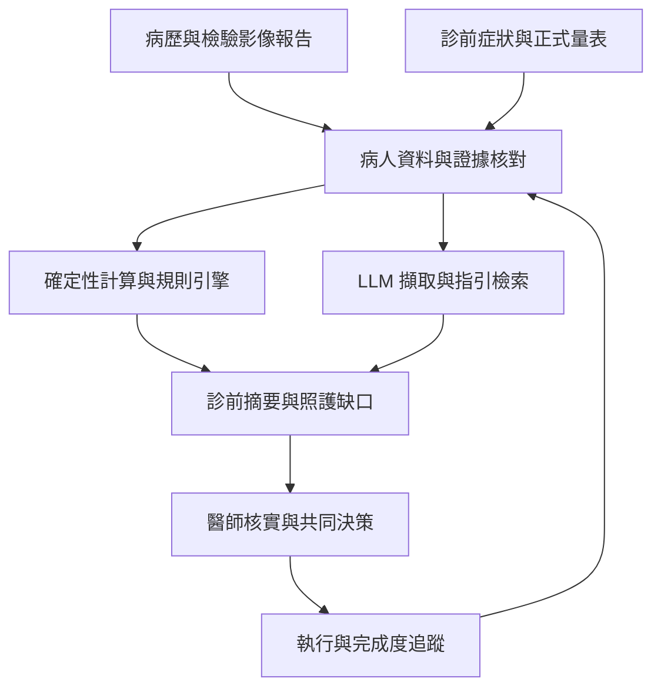
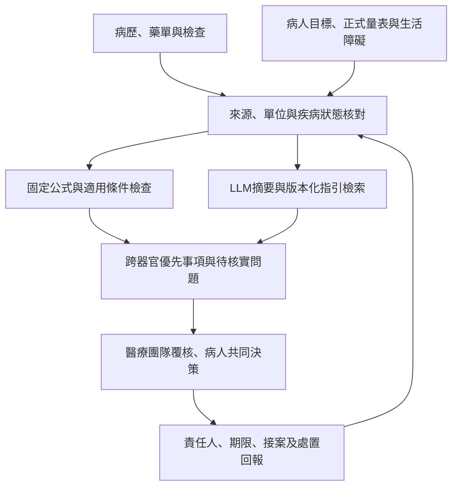

# 糖尿病門診複雜度、併發症與 AI 跨專業整合照護：文獻整合稿

整理日期：2026-11-11（台灣時間）  
資料範圍：原有11章與52個來源網址，新增整合照護、AI、心理證據與calculator規格；新增來源表含40筆研究/工具紀錄，與原索引有重疊。  
本次工作：保留既有整合稿，補充英文PubMed索引及primary sources主題式檢索與查核；包含公式版本、陰性證據、來源衝突與執行限制。未完成全面資料庫匯出及正式雙人篩選，不是系統性回顧；Claude獨立審查仍待完成。

## 閱讀重點

- 從糖尿病門診的資訊、時間與照護負擔出發，整合生理、疾病、心理、知識、飲食及社會層面。
- 將併發症與共病的篩檢接到診斷確認、治療、專科轉介與完成度追蹤。
- 並列台灣共同照護制度、整合照護臨床研究、AI／LLM 證據與可實作的系統規劃。
- 保留不同研究設計、適用範圍與限制；原始文章及官方來源可由文中連結與文末索引查閱。

## 目錄

- [糖尿病門診的多重複雜度](#part-01)
- [台灣現有的跨專業糖尿病照護](#part-02)
- [整合生理心理與自我照護的臨床研究](#part-03)
- [併發症與共病的篩檢](#part-04)
- [篩檢異常後的治療與轉介](#part-05)
- [AI 如何支援跨專業照護流程](#part-06)
- [AI 臨床研究的證據範圍](#part-07)
- [台灣已有的 AI 與 LLM 應用](#part-08)
- [既有 GitHub 專案的延伸方向](#part-09)
- [一頁式診前摘要範例](#part-10)
- [導入與研究評估](#part-11)
- [文獻與官方來源總表](#reference-index)

新增閱讀入口：[深入研究補充](../docs/12-deep-research-update.md)、[Calculator公式與心理計分](../docs/13-calculator-specifications.md)、[檢索規格](SEARCH_PROTOCOL_20261111.md)、[實際執行狀態](../workflow/EXECUTION_STATUS_20261111.md)。

## 導言

糖尿病門診的核心挑戰，是在有限時間內，同時理解病人的血糖、器官疾病、心理狀態、知識與自我照護能力、飲食和生活限制，再把判斷轉成病人做得到、團隊接得住、後續能追蹤的照護計畫。AI 最有價值的用途，是協助跨專業團隊整理資料、辨識需要處理的問題與維持追蹤，讓醫師有更多時間核實風險、理解病人的選擇並共同決策。

這套構想可定位為「AI 輔助糖尿病全人評估與跨專業整合照護」，英文可用 AI-assisted whole-person assessment and interdisciplinary diabetes care。以下以成人第 2 型糖尿病門診為主；第 1 型糖尿病、孕期與兒少需採各自適用的照護路徑。臨床架構參照 ADA 2026 等指引；台灣制度採健保署公開之 2026 年 4 月 1 日生效版本，研究與政策資料查核至 2026 年 11 月 11 日。既有 GitHub 程式評述保留原查核 commit 的範圍。

<a id="part-01"></a>

## 1. 糖尿病門診的多重複雜度

若一次問診只有五到十分鐘，醫師必須先理解血糖變化、核對用藥與低血糖，處理當天不適，還要判斷心臟、腎臟、眼睛、神經及足部的長期風險。這個時間情境反映臨床問題，並非台灣全國門診時間的統計估計。真正費時的工作，還包括確認資料是否完整、解釋互相矛盾的訊息，以及協調多個同樣合理卻未必能同時執行的治療目標。

例如，HbA1c 偏高的病人，也可能同時有夜間低血糖；有 CKD、肥胖與肌少風險的病人，可能收到彼此難以協調的飲食建議；需要密集眼科治療的病人，可能因工作與交通無法按時回診。這些情境需要把疾病風險、治療安全性與生活條件放在一起判斷。

| 複雜度面向 | 門診需要理解的內容 | 對決策的影響 |
| --- | --- | --- |
| 血糖與急性安全 | HbA1c 趨勢、SMBG／CGM 型態、TIR／TBR、低血糖感知、進食與用藥時序；必要時確認 HbA1c 與實測血糖不一致的原因。 | 同樣的 HbA1c 可能需要不同處置，須先釐清低血糖與波動。 |
| 併發症與共病 | ASCVD、HF、CKD、DR、神經病變、PAD、足病、MASLD；另看肥胖、睡眠、認知及功能。 | 影響器官保護用藥、治療目標、檢查與轉介優先順序。 |
| 藥物與治療負擔 | 真正正在使用的藥物、注射技巧、腎功能調整、交互作用、副作用、費用及多科處方。 | 「已開立」不等於「正在使用」；未使用某藥也可能有合理原因。 |
| 心理與情緒 | 憂鬱、焦慮、糖尿病困擾、低血糖恐懼、睡眠與家庭壓力。 | 影響自我照護；糖尿病困擾與憂鬱症需分別評估。 |
| 知識與實際技能 | 是否理解疾病、藥物、低血糖處理與生病日原則；是否能操作儀器、辨識食物份量與回述計畫。 | 分清楚「不知道」「不會做」「做不到」與「目前不願意」，才能選擇有效協助。 |
| 飲食與日常生活 | 外食、輪班、供餐者、預算、食物取得、文化偏好、咀嚼吞嚥與腸胃問題。 | 營養計畫必須符合實際食物、時間與共病限制。 |
| 家庭與社會資源 | 照顧者、交通、工作、經濟、語言、數位能力與支持系統。 | 決定病人能否取得藥物、使用科技及完成檢查與轉介。 |
| 資訊與跨科協調 | 院內外病歷、不同日期的檢驗、眼科與心臟科報告、營養及衛教紀錄。 | 需辨識資料來源、時效、缺漏與衝突，維持共同照護目標。 |
| 行政與品質管理 | 收案資格、追蹤週期、年度評估、必要紀錄、資料上傳及品質指標。 | 團隊同時處理臨床工作與制度要求，並區分已執行、已記錄及已申報。 |

這個架構與 ADA 的整體評估、社會健康決定因素及自我管理支持方向相符。上表是臨床工作整理，並非已驗證的複雜度量表，也不表示每次都要重做全部評估。[ADA 2026 整體評估](https://doi.org/10.2337/dc26-S004)、[族群照護](https://diabetesjournals.org/care/article/49/Supplement_1/S13/163920/1-Improving-Care-and-Promoting-Health-in)、[DSMES 與營養心理照護](https://diabetesjournals.org/docm-care/article-pdf/1/3/501/860536/docm26a005.pdf)

學術上，Safford 等人的 **Vector Model of Complexity** 強調生物、社會經濟、文化、環境及行為因素的交互作用。Shippee 等人的 **Cumulative Complexity Model** 則把病人需要完成的工作，與其體力、心理、時間和資源所能負擔的能力放在同一框架中。這有助於理解：增加檢查與治療，若沒有同步補上支持，也可能增加病人的負擔。[Safford 等，2007](https://pmc.ncbi.nlm.nih.gov/articles/PMC2219701/)、[Shippee 等，2012](https://doi.org/10.1016/j.jclinepi.2012.05.005)

時間限制也有研究支持。Porter 等人的美國基層照護模擬，以 2,500 名成人照護名單估算，單一醫師若完成全部建議服務與文書，每日需 26.7 小時；導入團隊分工後仍需 9.3 小時。這是模型估算，不能直接套成台灣糖尿病門診工時，但說明完整照護需要工作重新分配。[Revisiting the Time Needed to Provide Adult Primary Care](https://pmc.ncbi.nlm.nih.gov/articles/PMC9848034/)

整合照護需要一份持續更新的病人全貌，同時回答：目前已有哪些疾病？哪些異常尚待確認？未來最值得預防的事件是什麼？哪些評估、治療或轉介尚未完成？這些醫療問題還要連結兩項資訊：病人目前最在意什麼，以及哪些障礙會影響計畫的執行。

<a id="part-02"></a>

## 2. 台灣現有的跨專業糖尿病照護

台灣已有糖尿病共同照護網、專業人員認證及健保品質支付的基礎。共同照護網側重團隊能力與合作，健保方案則規範收案、服務、紀錄與支付；兩者相互支持，但名稱和功能不宜完全混用。[國健署共同照護網與認證說明](https://health99.hpa.gov.tw/storage/pdf/materials/22628.pdf)

健保署自 2022 年整合糖尿病與初期慢性腎臟病照護，目的是讓符合條件的共病患者在同次就醫接受兩者的追蹤與衛教，減少服務分散。[健保署英文說明](https://www.nhi.gov.tw/en/cp-18606-44adb-8-2.html)

依 2026 年 4 月 1 日生效的支付標準，Early CKD 的收案範圍涵蓋符合條件的第 1、2、3a 期；糖尿病合併 Early CKD 有共同追蹤與年度評估項目。此處的「初期慢性腎臟病」是已存在的 CKD，與「糖尿病前期」不同。病情進展時須接續適當的腎臟專科或 Pre-ESRD 照護。[現行支付標準](https://www.nhi.gov.tw/ch/dl-65879-e1d3294beea24125ac05b832243bd9f3-1.pdf)

同一份文件的附表 8.2.2 與 8.2.3 已列入營養治療、心理社會調適、糖尿病知識、自主管理技能及轉診追蹤。這表示全人評估已有制度基礎；文件列有評估項目，與每位病人是否完整接受、資訊是否真正互通，仍是不同層次。[照護方案與附表入口](https://www.nhi.gov.tw/ch/cp-14177-adf81-3576-1.html)

以臺大醫院公開服務為例，糖尿病衛教團隊由內科、護理、營養與藥劑共同支援，服務包含個別與團體衛教、病變篩檢、器材教學、個案追蹤及登錄。這是具體院所實務，不能推定所有院所配置相同。[臺大糖尿病衛教小組](https://www.ntuh.gov.tw/nurse/Fpage.action?fid=5477&muid=7720)

以下為依制度與臨床需求整理的分工建議；心理師、社工及其他專科依需求加入，並非每次就診都必須會齊。

| 團隊角色 | 主要責任 | 應回寫至共同照護計畫的資訊 |
| --- | --- | --- |
| 醫師 | 診斷核實、風險排序、治療選擇與共同決策。 | 本次目標、處置、暫緩原因與追蹤條件。 |
| 個案管理師或護理衛教師 | 症狀與技能評估、衛教、檢查安排、失聯與轉介追蹤。 | 未完成項目、病人困難、完成證據及下一次聯繫。 |
| 營養師 | 評估攝取、食物取得、生活型態及不同共病的營養需求。 | 可執行的餐食調整與需要醫師協調的限制。 |
| 藥師 | 用藥整合、實際服法、副作用、交互作用與使用障礙。 | 有效藥單、疑慮、理解程度及後續確認事項。 |
| 心理或精神醫療人員 | 正式心理評估與適當心理、精神醫療介入。 | 與糖尿病計畫相關的功能影響及協作需求。 |
| 社工與照顧者 | 經濟、交通、家庭、照顧資源及服務銜接。 | 具體資源、可提供的協助與仍未解決的障礙。 |
| 心臟、腎臟、眼科、血管及足部團隊 | 特定疾病確認、治療與專科追蹤。 | 分期、治療內容、回診安排及需要原團隊處理的事項。 |

品質管理宜同時保留「臨床適用性」與「行政完整性」：未找到眼底報告，可能是未檢查、外院已做、尚未匯入或影像不可判讀；有轉介單，也不代表專科評估已完成。品質指標使用的門檻，則應與個別患者的治療目標分開儲存。

<a id="part-03"></a>

## 3. 整合生理心理與自我照護的臨床研究

下列研究提供不同面向的整合經驗。TEAMcare 與 INDEPENDENT 最接近心理與身體疾病共同管理；JADE 與 CARRS 則更接近結構化資料、決策支援與個案追蹤。它們並非同一種介入，也不能全部稱為 LLM 或自主 agent。

| 研究 | 整合方式 | 主要結果與適用界線 |
| --- | --- | --- |
| **TEAMcare，NEJM 2010，214 人** | 護理照護管理師與醫師協作，同時處理憂鬱、糖尿病／冠心病風險、用藥及自我照護。 | 12 個月的多項疾病控制、憂鬱、生活品質與滿意度改善；飲食與運動遵行的部分結果未有顯著組間差異，不能推論全部生活面向都改善。[原始研究](https://pmc.ncbi.nlm.nih.gov/articles/PMC3312811/) |
| **INDEPENDENT，JAMA 2020，404 人** | 在印度糖尿病門診加入照護協調員、電子決策支援與精神醫療及糖尿病專家共同討論。 | 24 個月時，憂鬱改善加上至少一項心代謝指標改善的複合結果較佳；主要適用於合併憂鬱且控制不佳的族群。[原始研究](https://jamanetwork.com/journals/jama/fullarticle/2769466) |
| **CARRS，Annals of Internal Medicine 2016，1,146 人** | 非醫師照護協調員支持病人執行計畫，電子病歷決策支援協助醫師調整治療。 | 多重糖尿病照護目標達成較佳；效果來自整套介入，不能單獨歸功於軟體。[原始研究](https://pmc.ncbi.nlm.nih.gov/articles/PMC6561084/) |
| **JADE，JAMA Network Open 2021，20,834 人** | 亞洲多國含台灣，以結構化評估、個人化報告、風險分層與護理聯繫整合照護。 | 12 個月多重心代謝目標達成改善，但主要臨床事件未顯著減少；對照組也接受部分結構化評估。[原始研究](https://pubmed.ncbi.nlm.nih.gov/33929522/) |
| **JADE DKD，JAMA Network Open 2022，2,393 人** | 對 DKD 比較結構化評估、個人報告與電話支持，再加上醫師護理團隊定期面談。 | 加入團隊面談較有利於多重治療目標達成；不能把達標者事件較少的關聯直接當成隨機組間的腎臟終點效益。[原始研究](https://pmc.ncbi.nlm.nih.gov/articles/PMC8956973/) |
| **台灣糖尿病 P4P 世代研究，2020** | 使用健保資料比較參與多專業照護方案與配對未參與者。 | 參與與較低全因死亡風險相關；屬觀察研究，仍有選擇及殘餘混雜，不能視為隨機試驗。[原始研究](https://pmc.ncbi.nlm.nih.gov/articles/PMC7035087/) |

這些研究對系統設計的共同啟示是：評估之後需要有人解釋結果、處理執行障礙、調整治療及持續追蹤。能產生完整報告，是照護流程的一個環節。

<a id="part-04"></a>

## 4. 併發症與共病的篩檢

**先分清楚併發症、共病與風險因子。** 傳統微血管併發症包括視網膜病變、糖尿病相關腎臟病與神經病變；大血管疾病包括冠狀動脈疾病、缺血性腦血管疾病與周邊動脈疾病。心衰竭、MASLD、肥胖、憂鬱與認知功能障礙也會影響糖尿病照護，但個別患者的因果關係不能全部歸因於糖尿病。已有糖尿病的人出現腎功能下降或手麻，仍須考慮其他病因。

病歷擷取也必須保留事件的真正意思。「曾做心導管」不等於已證實阻塞性 CAD；「中風」要保留缺血性或出血性分類；「截肢」要確認原因；家族病史不能當成本人的疾病。系統需要讀取報告內容與時間，而不能只搜尋關鍵字。

**篩檢應有共同的基本項目，再依風險增加檢查。** 下表是成人門診的實務骨架；有症狀或急性變化時，應進入診斷流程，不受例行篩檢間隔限制。

| 領域 | 基本評估與時機 | 陽性或高風險後的處理方向 |
| --- | --- | --- |
| ASCVD 與腦血管疾病 | 核對 MI、CAD、血管重建、缺血性中風／TIA、PAD，並評估 BP、血脂與吸菸。 | 已有 ASCVD 採次級預防路徑；無症狀且危險因子已處理者，不常規普篩 CAD。[ADA 第 10 章](https://doi.org/10.2337/dc26-S010) |
| 心衰竭 | 詢問活動喘、端坐呼吸、水腫；可考慮 BNP／NT-proBNP 篩檢無症狀的心臟結構或功能異常。 | BNP ≥50 或 NT-proBNP ≥125 pg/mL 為此篩檢路徑的異常門檻，接續心臟超音波與臨床評估；這些不是急性心衰竭的確診切點。[ADA 第 10 章](https://doi.org/10.2337/dc26-S010) |
| 腎臟 | 第 2 型糖尿病診斷起，至少每年同時檢查 eGFR 與 UACR；第 1 型一般自病程滿 5 年起。 | CKD 依分期與風險增加追蹤，通常每年 1–4 次；核對持續性及其他腎病可能。[ADA 第 11 章](https://doi.org/10.2337/dc26-S011) |
| 視網膜 | 第 2 型診斷時、第 1 型發病後 5 年接受初始眼科檢查；一般每年，連續正常且控制穩定者可考慮 1–2 年。 | 有病變、影像不可判讀或視力變化，接眼科評估；病變進展者縮短間隔。[ADA 第 12 章](https://doi.org/10.2337/dc26-S012) |
| 周邊與自主神經 | 第 2 型診斷起、第 1 型病程滿 5 年起，至少每年問症狀並做感覺檢查；納入姿勢性頭暈、腸胃、排尿、性功能與出汗變化。 | 症狀不典型、非對稱或運動障礙，評估其他病因；必要時轉神經科。[ADA 神經病變立場聲明](https://doi.org/10.2337/dc16-2042) |
| 足部與 PAD | 足部至少每年檢視皮膚、變形、脈搏及保護性感覺。對有症狀、脈搏異常或選定高風險者做 ABI 等檢查。 | 有保護性感覺喪失或既往潰瘍／截肢者，每次就診檢視；依 IWGDF 風險安排追蹤。[ADA 第 12 章](https://doi.org/10.2337/dc26-S012)、[IWGDF](https://iwgdfguidelines.org/wp-content/uploads/2023/07/IWGDF-Guidelines-2023.pdf) |
| MASLD 與肝纖維化 | 第 2 型糖尿病即使 ALT 正常，也應評估纖維化風險；先計算 FIB-4。 | 一般門檻 ≥1.3 接 VCTE 或 ELF；高齡與年輕成人需特殊判讀。高風險轉肝膽科。[ADA 第 4 章](https://doi.org/10.2337/dc26-S004) |
| 低血糖與治療負擔 | 對有低血糖風險者，每次就診詢問事件；至少每年評估低血糖感知。 | 檢視 insulin／SU 等用藥、飲食、腎功能、CGM 與個別化血糖目標。[ADA 第 6 章](https://doi.org/10.2337/dc26-S006) |
| 心理與自我照護 | 至少每年以適當量表篩檢憂鬱、diabetes distress 等；出現併發症或生活重大改變時重評。 | 篩檢陽性後安排臨床評估；區分憂鬱症、糖尿病困擾與其他壓力來源。[ADA 第 5 章](https://doi.org/10.2337/dc26-S005) |
| 高齡與其他共病 | ≥65 歲初診及每年評估認知；另依病況納入衰弱、跌倒、營養、睡眠、口腔與聽力等。 | 將結果連結至用藥簡化、照顧者支持及適當轉介。[ADA 第 13 章](https://doi.org/10.2337/dc26-S013) |

眼底攝影與經驗證的影像 AI 可支援篩檢，但需要品質控管與轉介流程；治療由視網膜病變分期、是否有黃斑部水腫及視功能等決定，不能由「有出血」直接推論一定要雷射。[ADA 第 12 章](https://doi.org/10.2337/dc26-S012)

**幾項檢查的意義，直接影響 AI 如何下結論。** 腎臟評估要同時看 eGFR 與 UACR；一般尿蛋白試紙不能完整取代 UACR。eGFR <60 mL/min/1.73 m² 或 UACR ≥30 mg/g 是重要異常訊號，但單次異常不能自行證明慢性腎臟病；需建立至少 3 個月的慢性證據。UACR 有生物變異，通常需在 3–6 個月內的三次檢體中至少兩次異常，並考慮感染、運動等暫時影響。[KDIGO 2024](https://doi.org/10.1016/j.kint.2023.10.016)、[ADA 第 11 章](https://doi.org/10.2337/dc26-S011)

正式名稱是 **MASLD**，即 metabolic dysfunction-associated steatotic liver disease。FIB-4 以年齡、AST、ALT 與血小板估計纖維化風險；VCTE／FibroScan 才提供肝臟硬度測量。依 EASL 2024，>65 歲的低風險分流門檻改為 2.0，<35 歲表現較差；FIB-4 >2.67 屬高風險，需進一步評估。低風險通常 1–3 年重評，並依臨床情境調整。系統應明確採用哪一版指引及其年齡邊界。[EASL–EASD–EASO 2024](https://easlcampus.eu/sites/default/files/2024-08/EASL_CPGs_management_of_MASLD.pdf)

BNP／NT-proBNP 要連同肥胖、腎功能、心房顫動等背景判讀；肥胖可能壓低數值，其他共病則可能使其升高。正常射出分率也不能單獨排除 HFpEF。[ADA 第 10 章](https://doi.org/10.2337/dc26-S010)

ABI 在糖尿病及 CKD 可能受不可壓縮血管影響。ABI >1.40 時，疑似 PAD 者應接趾壓／TBI 與波形；有活動性腿部症狀但靜態 ABI 正常或邊界者，仍可能需要運動 ABI。系統不能把一次正常或偏高的 ABI 一律標成「無 PAD」。[ACC／AHA PAD 指引](https://www.ahajournals.org/doi/full/10.1161/CIR.0000000000001251)

Sudoscan 與 QST 可保留為補充檢查欄位，但不能取代基本神經與足部評估。Sudoscan 主要提供汗腺相關功能訊息；QST 仍依賴受測者回應。神經評估須結合病史、溫度或針刺與 128 Hz 音叉震動覺；足部以 10 g 單股尼龍絲評估保護性感覺，並考慮 B12 缺乏、甲狀腺疾病、腎病等其他原因。將「量化測量」等同「已確診糖尿病神經病變」會造成分類錯誤。[ADA 神經病變立場聲明](https://doi.org/10.2337/dc16-2042)

心理評估同樣需要本人提供資料。AI 可以找出過去病歷中的情緒困擾、睡眠變化或照護負擔，並協助完成 PHQ-2／PHQ-9、DDS／PAID 等適當量表；但不能由未回診、HbA1c 偏高或用藥不規律自行診斷憂鬱，也不能代填缺失的量表題目。量表陽性需要臨床評估；出現自傷意念等高風險回答時，依院內流程即時交由人員處理。[ADA 心理照護](https://doi.org/10.2337/dc26-S005)

<a id="part-05"></a>

## 5. 篩檢異常後的治療與轉介

每項評估都應連到下一個臨床行動。系統除了記錄疾病是否存在，也要保留診斷確認、適應症評估、治療選擇、責任人及追蹤結果。以下為成人第 2 型糖尿病的處理方向，實際選擇需結合個別病況與台灣給付條件。

| 領域 | 異常後需確認 | 治療與團隊接續 |
| --- | --- | --- |
| **心衰竭** | 症狀、心臟超音波、EF 與其他病因；不能只憑 BNP／NT-proBNP 確診。 | 確立 HF 後評估有實證的 **SGLT2 抑制劑**，涵蓋 HFrEF 與 HFpEF；HFrEF 同時完成其他適用的指引治療與鬱血處理。由心臟科共同管理，追蹤症狀、體液、血壓及腎功能。[ADA 心血管](https://doi.org/10.2337/dc26-S010) |
| **CKD 或白蛋白尿** | eGFR＋UACR 的持續性、G／A 分層、血鉀及非糖尿病腎病的可能。 | 依適應症評估 ACEi／ARB、SGLT2i、有腎心保護證據的 GLP-1 RA，以及適用的 finerenone；追蹤血鉀、腎功能與 UACR，必要時腎臟科共管。[ADA 腎臟](https://pmc.ncbi.nlm.nih.gov/articles/PMC12690176/) |
| **視網膜病變與黃斑部水腫** | 眼科確認分期、是否侵犯黃斑中心及視力影響。 | 高風險增殖性病變可採全視網膜雷射；部分 PDR 可選 anti-VEGF；侵犯中心且影響視力的 DME，多以 **anti-VEGF 為第一線**。將可否持續回診納入選擇。[ADA 眼科](https://doi.org/10.2337/dc26-S012) |
| **PAD 或 ABI 異常** | 症狀、脈搏、ABI 可信度；必要時 TBI／波形、運動 ABI 或血管影像。 | 控制危險因子、戒菸、降脂，依症狀與出血風險評估抗血小板／抗栓；穩定症狀者安排結構化運動。威脅肢體的缺血需緊急或快速血管評估，必要時重建血流。[ACC／AHA PAD](https://www.ahajournals.org/doi/full/10.1161/CIR.0000000000001251) |
| **神經病變與足病** | 痛覺／感覺、保護性感覺、傷口與感染缺血；評估其他神經病因。 | 疼痛型病變可用適合的 SNRI 或 gabapentinoid 等；依腎功能和耐受性選藥。足部潰瘍需卸壓、傷口照護與感染／血流處理，接足部團隊。[ADA 神經與足部](https://doi.org/10.2337/dc26-S012) |
| **ASCVD 或中風病史** | 確認病型、事件及既有專科治療。 | 次級預防包括適當降脂、血壓與抗血栓策略；T2D 依適應症選擇有實證心血管效益的 GLP-1 RA／SGLT2i，並協調多科藥物。[ADA 心血管](https://doi.org/10.2337/dc26-S010) |
| **MASLD 與纖維化風險** | FIB-4 後接適當第二階段檢查；高風險確認纖維化與其他肝病。 | 營養、活動、體重及代謝風險管理；高風險或疑似進展期疾病轉肝膽科，評估專科治療與追蹤。[EASL–EASD–EASO](https://easlcampus.eu/sites/default/files/2024-08/EASL_CPGs_management_of_MASLD.pdf) |

腎臟用藥提示必須附條件。例如 T2D 合併 CKD 的 SGLT2i，ADA 建議可於 eGFR ≥20 mL/min/1.73 m² 起始；ACEi／ARB 尤其適用於合併高血壓與白蛋白尿者；finerenone 需核對腎功能、血鉀、白蛋白尿及現有 RAS 阻斷治療。國際指引適應性與台灣個別藥品給付資格，應各自核對，不可互相代替。[ADA 腎臟治療建議](https://pmc.ncbi.nlm.nih.gov/articles/PMC12690176/)

心理、飲食與知識也要有接續行動。正式量表或訪談發現問題後，先區分疾病、情緒負擔與生活障礙，再決定介入：

| 評估結果 | 接續工作 | 完成與否的依據 |
| --- | --- | --- |
| 憂鬱篩檢陽性或明顯情緒功能影響 | 臨床評估，依需求接心理治療、精神醫療或協作照護。 | 已接受評估、有計畫，並追蹤症狀與功能；不是只記錄分數。 |
| 糖尿病困擾或低血糖恐懼 | 找出具體困擾，調整負擔過重的計畫，提供問題解決與支持。 | 病人認同的目標、困擾變化及計畫可行性。 |
| 知識或操作技能不足 | 衛教師分次教學，以回述或回示確認理解與技能。 | 能以自己的話說明或實際操作；不是只勾選「已衛教」。 |
| 飲食執行困難 | 營養師核對實際餐食、工作及供餐條件，整合 CKD／HF 等需求。 | 訂出能實踐的調整；必要時與藥物時序共同修訂。 |
| 食物、交通或費用障礙 | 社工或個管協助資源及就醫安排，醫師評估簡化治療。 | 障礙是否改善、治療與轉介是否能持續。 |

這個接續流程依 DSMES、營養及心理照護原則整理；實際效果需以病人的理解、功能與執行情形評估。[ADA 2026 行為與福祉照護](https://diabetesjournals.org/docm-care/article-pdf/1/3/501/860536/docm26a005.pdf)

<a id="part-06"></a>

## 6. AI 如何支援跨專業照護流程

**AI agent 的工作應以可追溯的臨床資料為中心。** 建議將流程拆成資料、計算、判斷與溝通四種責任。原始資料中的患者身分、日期、單位、檢查狀態及來源必須先核對；語言模型負責從敘述中擷取線索、解釋與整理，確定性的程式負責公式、量表加總及明確規則，醫師負責臨床確認與處方決策。

| 工作 | 建議執行方式 | 交付內容 |
| --- | --- | --- |
| 診前病歷整合 | 院內核准的資料介接，整理病史、有效藥單、檢驗與專科報告。 | 每項附來源、日期與缺漏原因的時間序列。 |
| 病人需求與生活評估 | 簡短症狀及生活問題，必要時接正式量表；提供人員訪談替代數位填答。 | 病人最想解決的問題、飲食與用藥障礙、實際回答與未回答項目。 |
| 計算與分層 | 由版本固定、可測試的 calculator／風險模型執行。 | 數值、適用族群、輸入日期、單位與無法計算原因。 |
| 指引與治療檢核 | 規則引擎結合版本化指引檢索，分開核對台灣給付規則。 | 有理由的治療評估提示；保留禁忌、耐受性與病人偏好。 |
| 診間摘要與紀錄 | LLM 產生摘要草稿，由人員確認重要事實與計畫。 | 今日優先問題、衝突資訊、醫師與病人共同決定的行動。 |
| 跨專業協作 | 共用問題清單，分配給個管、營養、藥事、心理／社工及專科。 | 責任人、時程、待處理原因及完成證據。 |
| 診後衛教與追蹤 | 根據已核定計畫產生易懂說明，追蹤檢查、轉介及困難是否改善。 | 病人版待辦、待聯繫清單、需提早回報給人員的問題。 |
| 品質與行政 | 從真實服務紀錄整理登錄草稿與缺件。 | 區分「已做」「已記錄」「已上傳」；不把空白欄位自動填成完成。 |

FHIR 可作為資料交換方式，CDS Hooks 可在開啟病歷等工作流程節點呼叫決策支援；院內是否支援及如何對應，仍由資訊系統實際能力決定。[HL7 CDS Hooks](https://cds-hooks.hl7.org/)

下圖是建議的資料與決策流程；同一病人的紀錄、問卷與檢查結果匯入共同狀態，再由不同工具產生可覆核的結果。



第一版可使用一個主控 agent 呼叫多個受控工具；是否拆成多個 agent，應依模組責任、可測試性與維護需要決定。增加 agent 數量本身不代表臨床正確性提高。

**計算機必須回答明確的臨床問題。** 目前疾病分期、篩檢結果與未來事件機率，應分開呈現。

| 工具 | 回答的問題 | 使用界線 |
| --- | --- | --- |
| CKD G／A 分類 | 現有腎功能與白蛋白尿落在哪個分層？ | 慢性及病因需另行確認；分期不是透析機率。 |
| FIB-4 | 是否需要進一步評估進展期肝纖維化？ | 不是直接肝硬度，也不是未來肝硬化的百分比。 |
| BNP／NT-proBNP、ABI／TBI | 是否有需進一步評估的心臟或下肢血管異常？ | 結果受情境與測量限制影響。 |
| IWGDF 足部風險 | 應安排多密集的預防與追蹤？ | 依足部檢查分層，0／1／2／3 級分別約每年／6–12 月／3–6 月／1–3 月追蹤；缺檢查不可預設 0 級。[IWGDF](https://iwgdfguidelines.org/wp-content/uploads/2023/07/IWGDF-Guidelines-2023.pdf) |
| PREVENT | 無已知 CVD 的適用成人，其未來 CVD／ASCVD／HF 風險？ | 10 年估計適用 30–79 歲；30 年估計適用 30–59 歲。已有 CVD 不套用其初級預防估計。[AHA](https://professional.heart.org/en/guidelines-and-statements/prevent-calculator) |
| WATCH-DM | 第 2 型糖尿病、無既往 HF 者的 5 年新發 HF 住院風險？ | 應採已發表的指定版本與輸入，並檢查外部適用性。[原始研究](https://pubmed.ncbi.nlm.nih.gov/31519694/) |
| KFRE | CKD G3–G5 病人的 2／5 年腎衰竭風險？ | 不泛用於所有糖尿病或 G1–G2；端點及模型版本需標明。[KDIGO](https://doi.org/10.1016/j.kint.2023.10.016) |
| Karter 低血糖工具 | 第 2 型糖尿病未來 12 個月因低血糖急診／住院的風險？ | 不等同所有輕微低血糖的發生率。[原始研究](https://jamanetwork.com/journals/jamainternalmedicine/fullarticle/2649265) |

每次輸出至少記錄工具名稱、版本、適用條件、端點、時間範圍、輸入與資料日期。數值由程式計算，缺資料時顯示無法估計。台灣資料的校準與外部驗證，應與「是否正確實作原始公式」分別評估；既有外部驗證不等於已在院內驗證。

版本管理已有具體例子：AHA 在 **2026 年 10 月 14 日**修正 PREVENT 含 HbA1c 的附加及完整公式；基本模型與僅使用其他可選變項的公式未受影響。若未來接上 PREVENT，應核對此更新並保留舊版結果的來源，避免不同版本數值混在同一趨勢中。[AHA 更新說明](https://professional.heart.org/-/media/PHD-Files/Guidelines-and-Statements/PREVENT/PREVENT-Update-FAQ-101426.pdf)

疾病、風險與缺口也應分成不同欄位，允許同時存在。例如一位病人可以「已確診 CKD」「腎衰竭風險待估」且「UACR 追蹤逾期」。建議保留疾病狀態、風險結果、資料完整度與行動狀態四個面向。未檢查、未匯入、外院已做、影像不可判讀、病人暫緩，代表不同情況；沒有紀錄不能自動變成陰性或照護失敗。

<a id="part-07"></a>

## 7. AI 臨床研究的證據範圍

現有證據支持部分任務，但不同層次不能混用：規則型決策支援、預測模型、影像 AI、LLM 文書助手與 agent 流程編排，各有不同輸入、輸出及驗證方式。

| 系統或研究 | 實際處理的工作 | 證據與限制 |
| --- | --- | --- |
| **Diabetes Wizard，2011 隨機試驗** | EHR 規則引擎提供個別化用藥、檢驗與追蹤建議，嵌入診前工作流程。 | 11 間診所、2,556 名糖尿病患者，HbA1c 組間介入效果約 −0.26 個百分點；屬傳統 CDS，且伴隨流程改變，並非 LLM。[原始研究](https://pmc.ncbi.nlm.nih.gov/articles/PMC3022040/) |
| **糖尿病 LLM＋RAG 原型，JMIR 2026** | 以單一機構門診病歷微調模型，檢索知識後產生治療、檢驗及藥物提示。 | 已做受控開發評估，尚未在真實門診前瞻驗證；文句相似度或專家評分不能等同病人結局改善。[全文](https://formative.jmir.org/2026/1/e71541) |
| **Ambient AI scribe 隨機試驗** | 根據門診對話產生紀錄，減少醫師打字工作。 | 238 位門診醫師，Nabla 的紀錄時間較對照減少 9.5%，DAX 未顯著減少；這是文書效率結果，未證明完整糖尿病照護改善。[原始研究](https://pmc.ncbi.nlm.nih.gov/articles/PMC12768499) |
| **基層 LLM 決策支援，Nature Medicine 2026** | 肯亞 16 間機構的臨床人員使用 EMR 搭配或不搭配 LLM。 | 納入 9,691 人，14 天治療失敗的主要結果無顯著組間差異；非糖尿病專門試驗，提示流程改善仍須驗證臨床結果。[原始研究](https://www.nature.com/articles/s41591-026-04503-6) |
| **DIASENTINEL，EMNLP 2026** | 院內資料、風險模型、指引檢索與報告驗證。 | 任務是未來一年新發 T2D 風險，並非已確診糖尿病的全併發症照護。[論文](https://aclanthology.org/2026.emnlp-demos.32/) |
| **經驗證的眼底影像 AI** | 特定範圍的 DR 篩檢。 | 需接續不可判讀與異常轉介流程；單一影像任務驗證不代表全人診療能力。[ADA](https://doi.org/10.2337/dc26-S012) |
| **OpenClaw 與 Hermes Agent** | 工具呼叫、排程、記憶與流程編排。 | 兩者為不同通用軟體專案；平台功能本身不能作為糖尿病診療有效性的證據。[OpenClaw](https://docs.openclaw.ai/)、[Hermes](https://github.com/NousResearch/hermes-agent) |

本次查核的資料尚不足以支持「安裝一個通用 agent 後，即可可靠完成全部糖尿病併發症診療」。較可行的路徑，是把通用 agent 接在已驗證、受控的資料與臨床工具之上。「Globart」目前未能對應到可核實的官方 agent 專案，名稱確認前不列為已確認方案。

部署位置與資料去向也必須分開看：agent 執行在院內，不代表它呼叫的模型也在院內。臨床版本應明確設定可存取資料、允許呼叫的模型與工具、病人間隔離、保留政策及存取紀錄。病歷文字只作為待處理的資料，不能成為執行額外工具指令的授權。

<a id="part-08"></a>

## 8. 台灣已有的 AI 與 LLM 應用

**最接近本構想的公開案例，是健保署的「糖尿病風險評估與智慧衛教」試辦。** 健保署 2026 年 6 月公布的英文資料，說明以台灣資料及 DCSI 為基礎整合風險評估，再結合生成式 AI 提供個人化衛教；規劃透過健康存摺服務民眾，並在家庭醫師平台提供醫師決策參考。公告列有 40 家參與診所，相關成果於 2026 年 3 月活動發表。這是已公開的試辦方向，公告未提供隨機試驗的 HbA1c、住院或併發症成效，不能推定已全國普及或完成全人照護驗證。[健保署原文](https://www.nhi.gov.tw/en/cp-19748-976e7-8-2.html)

| 台灣案例 | 可借鏡的功能 | 公開證據層級 |
| --- | --- | --- |
| **奇美 A+ Copilots** | 跨資料庫整合病人資訊，供醫師、護理師、藥師與營養師分別使用；包含藥事資訊與飲食建議。 | 院方公開導入案例，能支持功能存在；宣傳中的效率數字不宜當成糖尿病隨機試驗結果。[院方英文介紹](https://www.chimei.org.tw/main/cmh_department/54220/english/news/20240712.html) |
| **北醫體系三院護理交班 LLM** | 把 LLM 接入既有護理資訊系統，產生交班草稿並由護理人員確認。 | 2026 年發表的開發與導入研究，前後比較顯示文書時間下降；非隨機試驗，也非糖尿病門診整體結果。[研究全文](https://pmc.ncbi.nlm.nih.gov/articles/13022550) |
| **國衛院糖尿病 LLM 對話機器人計畫** | 研究病人問答適切性與長期照護效益。 | 公開研究計畫，期間為 2025 年 8 月至 2026 年 7 月；計畫頁本身未提供已完成臨床成效，不能當成成功試驗。[國衛院計畫頁](https://ir.nhri.edu.tw/handle/3990099045/21119) |
| **三總 MEDIC GenAI** | 整合院內臨床資料，讓不同職類建立並嵌入工作流程的 LLM 應用。 | 院方 2026 年 11 月 4 日公告，平台自 11 月 2 日上線；屬實作公告，未等同糖尿病整合照護成效。[院方公告](https://wwwv.tsgh.ndmutsgh.edu.tw/news/191/102550/33828/15128) |

DCSI 或既有病歷可以提供疾病與風險線索，但當下的飲食困難、理解程度、心理感受及照顧資源，仍需病人與團隊補充。對台灣門診的設計建議，是讓既有共同照護網、個案管理與 AI 共用同一份可更新的照護計畫，並保留病人直接表達需求的管道。

<a id="part-09"></a>

## 9. 既有 GitHub 專案的延伸方向

**你的 GitHub 已提供這個系統的決策支援核心。** 依 [README](https://github.com/zinojeng/AI-agent-in-diabetes/blob/6180c4f2a56ae50ca5b6ec22e4795f7922a63a3f/README.md) 與核心程式檢視，目前已有資料型別、併發症辨識、分期／計算模組、照護缺口、用藥建議、醫師決策與診前摘要；這些是程式層級的實作，不表示已完成院內系統串接或臨床驗證。

| 項目 | 目前可確認的狀態 | 後續需要補上的工作 |
| --- | --- | --- |
| 資料整合 | 函式將傳入的病人、檢驗與檢查資料整理成共同物件。 | 真實 HIS／LIS／眼科等介接、單位與代碼對應、有效用藥及外院資料核對。[程式](https://github.com/zinojeng/AI-agent-in-diabetes/blob/6180c4f2a56ae50ca5b6ec22e4795f7922a63a3f/src/dm_care_pipeline/data_integration.py) |
| 確定性工具 | 已有 CKD G／A、FIB-4、BNP、ABI／TBI、低血糖與足部規則。 | 逐項核對指引及適用條件，建立臨床參考案例；Tier A 是專案內部分類，並非證據等級或認證。 |
| Tier B 預測模型 | WATCH-DM、PREVENT、KFRE、Karter 等目前是介面，回傳需要外部驗證模型，數值為空。 | 接入正確公式／係數及版本，再做程式比對與在地效能驗證。[共用骨架](https://github.com/zinojeng/AI-agent-in-diabetes/blob/6180c4f2a56ae50ca5b6ec22e4795f7922a63a3f/src/dm_care_pipeline/calculators/tier_b/_base.py) |
| FIB-4 分流 | 目前使用 1.3，對年齡 <35 或 >65 加警語。 | 將採用指引的高齡門檻、>2.67 分支與檢驗情境納入版本化規則。[程式](https://github.com/zinojeng/AI-agent-in-diabetes/blob/6180c4f2a56ae50ca5b6ec22e4795f7922a63a3f/src/dm_care_pipeline/calculators/fib4.py) |
| 整體風險 | `RuleBasedRiskCalculator` 明確標為示意方法。 | 不將其輸出當成經驗證的臨床風險；正式流程應替換或停用該結果。[程式](https://github.com/zinojeng/AI-agent-in-diabetes/blob/6180c4f2a56ae50ca5b6ec22e4795f7922a63a3f/src/dm_care_pipeline/risk.py) |
| 診前報告 | 已有摘要組裝與證據索引。 | 補病歷文字擷取、症狀與心理量表、實際介面及可用性驗證。[程式](https://github.com/zinojeng/AI-agent-in-diabetes/blob/6180c4f2a56ae50ca5b6ec22e4795f7922a63a3f/src/dm_care_pipeline/pre_visit_brief.py) |
| Agent 與族群管理 | README 明載尚無 LLM／多 agent 編排與跨病人批次管理。 | 在既有引擎外加受控呼叫層；族群排序另做驗證。 |

第一版適合先交付「病歷摘要＋篩檢完整度＋需醫師覆核的異常」。在用藥模組中，「沒有開某藥」應先顯示為待評估項目，並核對適應症、禁忌、血鉀與腎功能、過敏、耐受性、費用及病人偏好，再由醫師決定是否構成可改善的治療缺口。

用藥檢核可涵蓋合適 ASCVD／CKD／HF 情境下具有證據的 SGLT2 inhibitor、GLP-1 RA，以及適用時的 ACE inhibitor／ARB、finerenone 與降血脂治療；不同藥物的適用條件分開判斷。系統應產生附理由的評估提示，由醫師核對個人狀況後決定。[ADA 心血管](https://doi.org/10.2337/dc26-S010)、[ADA 腎臟](https://doi.org/10.2337/dc26-S011)

<a id="part-10"></a>

## 10. 一頁式診前摘要範例

以下為虛構示例，用來說明報告如何涵蓋疾病與生活脈絡，並非實際病人的診斷或處方。

| 報告區塊 | 示例內容 |
| --- | --- |
| 病人本次最在意的事 | 病人表示夜間不適與注射壓力影響睡眠，希望了解能否簡化治療。 |
| 血糖與安全 | HbA1c 偏高，但病人也回報疑似夜間低血糖；先核對實測資料與進食、用藥時序。 |
| 已確認疾病 | 心臟科報告證實 CAD；持續檢驗與既有評估支持 CKD，各列附來源日期。 |
| 需確認的異常 | NT-proBNP 異常而缺可取得的心臟超音波；列為待評估，不直接新增 HF 診斷。 |
| 飲食與知識 | 病人自述輪班、餐次不固定；注射與低血糖處理的實際技能尚待回示確認。 |
| 心理與社會 | 已回報治療困擾，正式量表與功能影響尚待評估；交通是否影響眼科回診需詢問。 |
| 治療評估 | 列出適用的腎心保護治療檢核，以及缺少的血鉀、藥物耐受性或其他決策資料。 |
| 篩檢與轉介 | 未找到近期眼底報告，先確認是否外院已做；已有轉介但無回覆者列為待追蹤。 |
| 今日優先事項 | 釐清低血糖安全；確認心肺症狀；與病人共同選定本次可執行的調整。 |
| 團隊接續 | 衛教師確認技能、營養師處理輪班餐食、個管追眼科與心臟資料；各有責任人及狀態。 |
| 品質登錄 | 顯示年度評估與資料上傳的真實狀態；沒有完成證據者保留待確認。 |

畫面可先顯示三個最重要問題，其他器官狀態與來源展開查看。高急迫性訊號、例行篩檢與行政缺件應分層，避免全部以相同警示打斷門診。衛教師、營養師、藥師與醫師共用這份問題清單，各自接續適合的工作。

<a id="part-11"></a>

## 11. 導入與研究評估

**研究與導入應分階段驗證。** 第一階段以去識別資料建立病歷擷取與規則參考集，由臨床人員確認標準答案，測量各器官疾病的漏抓、誤抓與證據是否正確；計算機另外核對官方或原始論文範例。預測模型須評估區辨力與校準，並使用病人層級、時間順序適當的驗證，避免資料洩漏。

第二階段在門診進行靜默運作，結果先供研究核對，不改變醫療處置，觀察資料取得率、錯誤警示與待辦合理性。第三階段再以受控試辦評估醫師整理時間、適當篩檢完成率、轉介完成率、用藥建議採納原因及無依據敘述的比例。所有評估皆需考慮病人拒絕、外院已完成與臨床不適用等情況，不能把增加檢查數當作成功。

要證明減少住院、截肢、失明或腎衰竭，仍需要相應的前瞻研究與追蹤。短期最務實的研究問題是：這套系統是否能降低重要資訊遺漏，讓該做的評估及後續處理更完整，同時不增加不必要檢查與警示負擔。

評估還應納入病人與整個團隊的負擔：病人是否更理解計畫、飲食建議是否可行、糖尿病困擾是否改善，以及醫師、衛教師、營養師與個管的總工作時間是否下降。若只是把醫師的時間轉移成其他人更多的核對與補件，仍不能認定整體照護更有效率。建議把「適當行動完成率」與「病人負擔」並列為試辦指標，並預先定義不適用、病人暫緩及外院完成的處理方式。

這項系統的臨床目標，是讓疾病資料、病人的生活經驗與團隊照護任務形成同一份可追溯的計畫。醫師確認風險與治療選擇，病人參與目標設定，各專業處理自己能有效改善的障礙，AI 協助維持資料與任務的連續性。價值應體現在較少遺漏、較完整的後續處理，以及病人更能持續執行的糖尿病照護。

<a id="reference-index"></a>

## 文獻與官方來源總表

共 52 個不重複網址，包含研究論文、臨床指引、官方政策與軟體文件。以下沿用原稿來源標籤，未自行補出尚未查核的作者、標題或 DOI。研究設計、結果與限制需與上方相關章節一併閱讀；本檔不含期刊全文 PDF。

| 編號 | 原始來源 | 對應主題 |
| --- | --- | --- |
| REF-001 | [ADA 2026 整體評估／ADA 第 4 章](https://doi.org/10.2337/dc26-S004) | 糖尿病門診的多重複雜度；併發症與共病的篩檢 |
| REF-002 | [族群照護](https://diabetesjournals.org/care/article/49/Supplement_1/S13/163920/1-Improving-Care-and-Promoting-Health-in) | 糖尿病門診的多重複雜度 |
| REF-003 | [DSMES 與營養心理照護／ADA 2026 行為與福祉照護](https://diabetesjournals.org/docm-care/article-pdf/1/3/501/860536/docm26a005.pdf) | 糖尿病門診的多重複雜度；篩檢異常後的治療與轉介 |
| REF-004 | [Safford 等，2007](https://pmc.ncbi.nlm.nih.gov/articles/PMC2219701/) | 糖尿病門診的多重複雜度 |
| REF-005 | [Shippee 等，2012](https://doi.org/10.1016/j.jclinepi.2012.05.005) | 糖尿病門診的多重複雜度 |
| REF-006 | [Revisiting the Time Needed to Provide Adult Primary Care](https://pmc.ncbi.nlm.nih.gov/articles/PMC9848034/) | 糖尿病門診的多重複雜度 |
| REF-007 | [國健署共同照護網與認證說明](https://health99.hpa.gov.tw/storage/pdf/materials/22628.pdf) | 台灣現有的跨專業糖尿病照護 |
| REF-008 | [健保署英文說明](https://www.nhi.gov.tw/en/cp-18606-44adb-8-2.html) | 台灣現有的跨專業糖尿病照護 |
| REF-009 | [現行支付標準](https://www.nhi.gov.tw/ch/dl-65879-e1d3294beea24125ac05b832243bd9f3-1.pdf) | 台灣現有的跨專業糖尿病照護 |
| REF-010 | [照護方案與附表入口](https://www.nhi.gov.tw/ch/cp-14177-adf81-3576-1.html) | 台灣現有的跨專業糖尿病照護 |
| REF-011 | [臺大糖尿病衛教小組](https://www.ntuh.gov.tw/nurse/Fpage.action?fid=5477&muid=7720) | 台灣現有的跨專業糖尿病照護 |
| REF-012 | [原始研究](https://pmc.ncbi.nlm.nih.gov/articles/PMC3312811/) | 整合生理心理與自我照護的臨床研究 |
| REF-013 | [原始研究](https://jamanetwork.com/journals/jama/fullarticle/2769466) | 整合生理心理與自我照護的臨床研究 |
| REF-014 | [原始研究](https://pmc.ncbi.nlm.nih.gov/articles/PMC6561084/) | 整合生理心理與自我照護的臨床研究 |
| REF-015 | [原始研究](https://pubmed.ncbi.nlm.nih.gov/33929522/) | 整合生理心理與自我照護的臨床研究 |
| REF-016 | [原始研究](https://pmc.ncbi.nlm.nih.gov/articles/PMC8956973/) | 整合生理心理與自我照護的臨床研究 |
| REF-017 | [原始研究](https://pmc.ncbi.nlm.nih.gov/articles/PMC7035087/) | 整合生理心理與自我照護的臨床研究 |
| REF-018 | [ADA 第 10 章／ADA 心血管](https://doi.org/10.2337/dc26-S010) | 併發症與共病的篩檢；篩檢異常後的治療與轉介；既有 GitHub 專案的延伸方向 |
| REF-019 | [ADA 第 11 章／ADA 腎臟](https://doi.org/10.2337/dc26-S011) | 併發症與共病的篩檢；既有 GitHub 專案的延伸方向 |
| REF-020 | [ADA 第 12 章／ADA 眼科／ADA 神經與足部／ADA](https://doi.org/10.2337/dc26-S012) | 併發症與共病的篩檢；篩檢異常後的治療與轉介；AI 臨床研究的證據範圍 |
| REF-021 | [ADA 神經病變立場聲明](https://doi.org/10.2337/dc16-2042) | 併發症與共病的篩檢 |
| REF-022 | [IWGDF](https://iwgdfguidelines.org/wp-content/uploads/2023/07/IWGDF-Guidelines-2023.pdf) | 併發症與共病的篩檢；AI 如何支援跨專業照護流程 |
| REF-023 | [ADA 第 6 章](https://doi.org/10.2337/dc26-S006) | 併發症與共病的篩檢 |
| REF-024 | [ADA 第 5 章／ADA 心理照護](https://doi.org/10.2337/dc26-S005) | 併發症與共病的篩檢 |
| REF-025 | [ADA 第 13 章](https://doi.org/10.2337/dc26-S013) | 併發症與共病的篩檢 |
| REF-026 | [KDIGO 2024／KDIGO](https://doi.org/10.1016/j.kint.2023.10.016) | 併發症與共病的篩檢；AI 如何支援跨專業照護流程 |
| REF-027 | [EASL–EASD–EASO 2024／EASL–EASD–EASO](https://easlcampus.eu/sites/default/files/2024-08/EASL_CPGs_management_of_MASLD.pdf) | 併發症與共病的篩檢；篩檢異常後的治療與轉介 |
| REF-028 | [ACC／AHA PAD 指引／ACC／AHA PAD](https://www.ahajournals.org/doi/full/10.1161/CIR.0000000000001251) | 併發症與共病的篩檢；篩檢異常後的治療與轉介 |
| REF-029 | [ADA 腎臟／ADA 腎臟治療建議](https://pmc.ncbi.nlm.nih.gov/articles/PMC12690176/) | 篩檢異常後的治療與轉介 |
| REF-030 | [HL7 CDS Hooks](https://cds-hooks.hl7.org/) | AI 如何支援跨專業照護流程 |
| REF-031 | [AHA](https://professional.heart.org/en/guidelines-and-statements/prevent-calculator) | AI 如何支援跨專業照護流程 |
| REF-032 | [原始研究](https://pubmed.ncbi.nlm.nih.gov/31519694/) | AI 如何支援跨專業照護流程 |
| REF-033 | [原始研究](https://jamanetwork.com/journals/jamainternalmedicine/fullarticle/2649265) | AI 如何支援跨專業照護流程 |
| REF-034 | [AHA 更新說明](https://professional.heart.org/-/media/PHD-Files/Guidelines-and-Statements/PREVENT/PREVENT-Update-FAQ-101426.pdf) | AI 如何支援跨專業照護流程 |
| REF-035 | [原始研究](https://pmc.ncbi.nlm.nih.gov/articles/PMC3022040/) | AI 臨床研究的證據範圍 |
| REF-036 | [全文](https://formative.jmir.org/2026/1/e71541) | AI 臨床研究的證據範圍 |
| REF-037 | [原始研究](https://pmc.ncbi.nlm.nih.gov/articles/PMC12768499) | AI 臨床研究的證據範圍 |
| REF-038 | [原始研究](https://www.nature.com/articles/s41591-026-04503-6) | AI 臨床研究的證據範圍 |
| REF-039 | [論文](https://aclanthology.org/2026.emnlp-demos.32/) | AI 臨床研究的證據範圍 |
| REF-040 | [OpenClaw](https://docs.openclaw.ai/) | AI 臨床研究的證據範圍 |
| REF-041 | [Hermes](https://github.com/NousResearch/hermes-agent) | AI 臨床研究的證據範圍 |
| REF-042 | [健保署原文](https://www.nhi.gov.tw/en/cp-19748-976e7-8-2.html) | 台灣已有的 AI 與 LLM 應用 |
| REF-043 | [院方英文介紹](https://www.chimei.org.tw/main/cmh_department/54220/english/news/20240712.html) | 台灣已有的 AI 與 LLM 應用 |
| REF-044 | [研究全文](https://pmc.ncbi.nlm.nih.gov/articles/13022550) | 台灣已有的 AI 與 LLM 應用 |
| REF-045 | [國衛院計畫頁](https://ir.nhri.edu.tw/handle/3990099045/21119) | 台灣已有的 AI 與 LLM 應用 |
| REF-046 | [院方公告](https://wwwv.tsgh.ndmutsgh.edu.tw/news/191/102550/33828/15128) | 台灣已有的 AI 與 LLM 應用 |
| REF-047 | [README](https://github.com/zinojeng/AI-agent-in-diabetes/blob/6180c4f2a56ae50ca5b6ec22e4795f7922a63a3f/README.md) | 既有 GitHub 專案的延伸方向 |
| REF-048 | [程式](https://github.com/zinojeng/AI-agent-in-diabetes/blob/6180c4f2a56ae50ca5b6ec22e4795f7922a63a3f/src/dm_care_pipeline/data_integration.py) | 既有 GitHub 專案的延伸方向 |
| REF-049 | [共用骨架](https://github.com/zinojeng/AI-agent-in-diabetes/blob/6180c4f2a56ae50ca5b6ec22e4795f7922a63a3f/src/dm_care_pipeline/calculators/tier_b/_base.py) | 既有 GitHub 專案的延伸方向 |
| REF-050 | [程式](https://github.com/zinojeng/AI-agent-in-diabetes/blob/6180c4f2a56ae50ca5b6ec22e4795f7922a63a3f/src/dm_care_pipeline/calculators/fib4.py) | 既有 GitHub 專案的延伸方向 |
| REF-051 | [程式](https://github.com/zinojeng/AI-agent-in-diabetes/blob/6180c4f2a56ae50ca5b6ec22e4795f7922a63a3f/src/dm_care_pipeline/risk.py) | 既有 GitHub 專案的延伸方向 |
| REF-052 | [程式](https://github.com/zinojeng/AI-agent-in-diabetes/blob/6180c4f2a56ae50ca5b6ec22e4795f7922a63a3f/src/dm_care_pipeline/pre_visit_brief.py) | 既有 GitHub 專案的延伸方向 |

## 版本與使用範圍

原始整合稿第 2 版；原稿記載查核至 2026-11-11。台灣制度採原稿所引 2026-04-01 生效版本；既有程式評述限於 commit `6180c4f2a56ae50ca5b6ec22e4795f7922a63a3f`。本次重整不代表重新驗證該程式、政策或所有外部連結。臨床範圍以成人第 2 型糖尿病門診為主，個別治療仍需醫療團隊確認。


---

## 糖尿病併發症與全人整合照護：新增證據與落地架構

查核日期：2026-11-11，Asia/Taipei。以英文檢索 PubMed 索引、PMC、原始期刊與官方指引；這是針對臨床問題的主題式證據綜整，未完成全面去重、雙人篩選及正式 risk-of-bias 表，不能稱 systematic review。既有第 1–11 章保留；本章補強原稿的療效界線、心理介入及 AI 可驗證用途。完整檢索規格見 [SEARCH_PROTOCOL](../research/SEARCH_PROTOCOL_20261111.md)，來源與效應值見 [evidence matrix](../sources/evidence_matrix_20261111.csv)。

### 1. 核心結論

糖尿病整合照護的單位應是「病人及其照護問題」，而非單一 HbA1c 或每科各自的疾病。最重要的工作是共同確認疾病與優先目標、減少衝突處方和治療負擔、完成必要篩檢，並把異常接到評估、治療和再追蹤。心理健康、日常功能與病人的可執行能力需要一起進入照護計畫。

多重風險因子介入已有部分長期器官及死亡結局支持，但效果受族群、原有照護水準、介入強度與持續性影響。科技輔助個管與結構化評估有達標或流程效益；不能據此說 generative AI／agent 已證明能降低所有併發症。

### 2. 目前困難及需要整合的內容

| 困難 | 臨床後果 | 需要整合的資料與工作 | AI 可測試的協助方式（設計推論） |
| --- | --- | --- | --- |
| 單病種照護與資料分散 | 每科目標合理但整體負擔過大；重複檢查或漏看報告 | 同一份 problem list、有效藥單、病人目標、專科結論與責任人 | 抽取日期及來源，標示衝突與待核實項目 |
| Clinical inertia 與時間不足 | 該處理的風險長期未被回應 | 區分漏處理與合理暫緩：禁忌、低血糖、費用、偏好 | 提醒有證據的缺口，允許醫師填寫不處理理由 |
| 完成篩檢卻沒完成處置 | 有眼底 AI 結果但未看眼科；有蛋白尿但無後續評估 | 檢查→異常確認→轉介→到診→治療→回傳結論 | 建立未結案清單，不把開立轉介當成完成 |
| 多器官疾病與多重用藥 | 腎功能、K、容量、低血糖、營養與功能風險互相影響 | CKD/HF/ASCVD、frailty、用藥耐受性與實際服法 | 規則型安全檢核；LLM 解釋衝突及產生供覆核的摘要 |
| 心理與療程負擔未被看見 | 情緒壓力被誤認為不配合；增加療程反而更難執行 | Distress、depression、anxiety、低血糖恐懼、支持與交通經濟 | 保留病人原意，連到個管、心理、社工及療程簡化 |
| 健康識能與數位落差 | 不會用設備、無法填表或沒有網路者被排除 | Teach-back、語言、視聽覺、操作與照顧能力 | 提供簡明語言及人員協助替代路徑 |
| 團隊責任與資源不足 | 報告增加卻沒有人執行；alert fatigue | 個管工時、接案量、回覆時限、備援與跨科共用流程 | 只將可處理且有責任人的項目轉為任務 |

以上整理與整合照護實施研究及 ADA person-centered interprofessional care 一致；不同機制對結局的獨立效應仍不易分離。[Busetto implementation review](https://pubmed.ncbi.nlm.nih.gov/26772769/)、[ADA 2026 Section 4](https://pubmed.ncbi.nlm.nih.gov/41358897/)。

### 3. 整合照護的臨床證據：同時保留陽性與陰性結果

| 研究 | 族群及介入 | 主要結果 | 解讀與限制 |
| --- | --- | --- | --- |
| Steno-2，2003；160 人 | T2D＋microalbuminuria，多重風險因子介入，7.8 年 | CVD HR 0.47（95% CI 0.24–0.73）；nephropathy HR 0.39、retinopathy HR 0.42 | 支持高風險族群綜合處理，不能推估每個單一組件或 AI 的效益。[PMID12556541](https://pubmed.ncbi.nlm.nih.gov/12556541/) |
| Steno-2，21 年延伸追蹤 | 依原始隨機組追蹤；7.8 年後兩組皆採密集治療 | 死亡 HR 0.55（0.36–0.83），median survival 增加 7.9 年 | 不能寫成持續 21 年的隨機差異介入。[PMID27531506](https://pubmed.ncbi.nlm.nih.gov/27531506/) |
| ADDITION-Europe | 3,057 名篩檢發現 T2D；基層團隊多重因子處理 | 5 年 CVD HR 0.83（0.65–1.05）；10 年 HR 0.87（0.73–1.04） | 均未達顯著，不能只選 Steno-2 推論所有病人皆有同等效益。[5年](https://pubmed.ncbi.nlm.nih.gov/21705063/)、[10年](https://pubmed.ncbi.nlm.nih.gov/31748169/) |
| J-DOIT3 | 2,542 名日本 T2D，median 8.5 年 | 主要複合終點 HR 0.81（0.63–1.04），p=0.094 | 非嚴重低血糖 41% vs22%；更密集不必然等於更適當。[PMID29079252](https://pubmed.ncbi.nlm.nih.gov/29079252/) |
| CARRS，2016 | 1,146 名控制不佳 T2D，care coordinator＋EHR CDS | 多重目標達成 RR 2.24（1.71–2.92）；HbA1c 組間差約−0.50 percentage points | 組合式介入，不能單獨歸因軟體；不是 LLM。[PMID27398874](https://pubmed.ncbi.nlm.nih.gov/27398874/) |
| CARRS，6.5 年延伸分析 | 原隨機組 post-hoc follow-up | Micro/macrovascular 首發複合 HR 0.72（0.61–0.86）；microvascular HR 0.68（0.56–0.83） | Macrovascular 無明確差異；效益見於持續介入站點。後續追蹤與介入持續性須交代。[PMID38829880](https://pubmed.ncbi.nlm.nih.gov/38829880/) |
| JADE，2021 | 20,834 人、8 國50中心；結構化評估、個人報告、護理聯繫 | 12 個月多重心代謝目標改善，臨床事件未顯著減少 | 短期達標與事件效益須分開。[PMID33929522](https://pubmed.ncbi.nlm.nih.gov/33929522/) |
| JADE-DKD，2022 | 2,393 名 DKD，結構化回饋與 team-based empowered care | 支持多重治療目標改善 | 達標者事件較少的關聯，不是隨機組間硬終點因果效益。[PMID35333363](https://pubmed.ncbi.nlm.nih.gov/35333363/) |
| Taiwan P4P，2016／2020 | 配對健保資料世代 | 死亡 HR 0.76／aHR0.58 | 觀察關聯仍有選案、健康參與者及殘餘混雜。[2016](https://pubmed.ncbi.nlm.nih.gov/27399144/)、[2020](https://pubmed.ncbi.nlm.nih.gov/32049836/) |
| Integrated diabetes–kidney service | 196 介入 vs7,511 standard care，非隨機 | 住院 IRR **1.20**，LOS較短、死亡IRR較低 | **不能寫成降低住院**；對照資料不足以充分風險調整。[PMID34314493](https://pubmed.ncbi.nlm.nih.gov/34314493/) |

綜合證據也不能混用設計：Lim 等納入181 trials，HbA1c平均差−0.28 percentage points；Zarora 等 RCT 平均差約−0.10，而 pre-post 為−0.77，兩者不可互換。[Lim2018](https://pubmed.ncbi.nlm.nih.gov/29784698/)、[Zarora2022](https://pubmed.ncbi.nlm.nih.gov/35634254/)。足部 multidisciplinary team 回顧33篇中31篇報告 major amputation 減少，但沒有RCT；「94%研究報告改善」**不是截肢風險降低94%**。[PMID31676181](https://pubmed.ncbi.nlm.nih.gov/31676181/)。

### 4. 併發症如何跨器官整合

下表為依已核實指引與研究形成的實作提案；不是新量表、藥物處方或額外試驗結果。疾病已確診、疑似異常、未來風險及待辦事項要分欄。

| 領域 | 必須同時掌握 | 異常後的整合行動 | 完成證據 |
| --- | --- | --- | --- |
| Kidney | eGFR＋UACR趨勢、持續性、K、血壓、容量、藥物 | 核實 CKD 及其他腎病可能；評估適合的 ACEi/ARB、SGLT2i、finerenone、GLP-1RA 等器官保護策略與轉介 | 複驗、適用性/未用理由、監測及腎科結論 |
| Heart/vascular | ASCVD、HF症狀、EF/結構、BP、lipids、smoking、PAD | 依已確診疾病處理，協調容量/腎功能/低血糖與藥物；急性症狀不等待風險分數 | 診斷、治療及追蹤計畫；無ASCVD者才選適用初級預防模型 |
| Liver | MASLD風險、FIB-4、肝酵素、platelets、飲酒與其他病因 | 合適時接 VCTE/ELF或 hepatology；ALT正常不能排除 fibrosis | 第二線檢查與專科判讀，非只有FIB-4數字 |
| Eye | DR分級、黃斑部問題、影像品質、視力症狀、眼科處置 | AI abnormal/ungradable接眼科；視力急變依症狀優先評估 | 到診、病變確認、處置與下次追蹤日期 |
| Foot/nerve/PAD | 保護性感覺、脈搏、變形、既往潰瘍/截肢、腎衰竭 | IWGDF分層連接足部照護；潰瘍整合 infection、perfusion、offloading與wound care | 足部檢查及分期、轉介/處置；不是僅填有無足病 |
| Function/safety | 嚴重低血糖、跌倒、認知、frailty、視聽與用藥能力 | 調整個別目標、簡化療程，協調家屬/照護與營養 | 可執行計畫與teach-back、低血糖處理能力 |
| Psychosocial | Distress、depression/anxiety、恐懼、工作/交通/費用、病人優先目標 | 對應病人問題而非一律加衛教；必要時心理/精神/社工及藥物評估 | 人工評估、接受/暫緩理由、後續接案與量表/功能變化 |

藥物是否適用、台灣核准與健保給付需分別核對；不能把國際指引適應性直接當給付資格。原有第4–5章提供指引與轉介細節。

### 5. 心理整合不是附加一個 chatbot

Diabetes distress 是與疾病及自我管理相關的情緒負擔，與 depression 或 anxiety 有重疊但不同；PHQ-9低分不能排除高度糖尿病困擾。情緒狀況也不是「依從性差」的代稱。至少應在常規回顧及發生併發症、治療變動、轉銜、未達目標等情況重新評估。[ADA2026 Section5](https://pubmed.ncbi.nlm.nih.gov/41358898/)。

2026 EASD diabetes distress guideline 已於**2026-09-15線上發表**，紙本卷期為2026 Dec。它支持例行情緒對話、validated instruments、共同照護計畫、紀錄及可取得的心理支援。T1D的心理介入及CGM/AID、T2D的心理/心理教育/教育介入為 conditional recommendations；不宜改寫成所有心理介入皆有高確定性效果。[PMID42744915](https://pubmed.ncbi.nlm.nih.gov/42744915/)。

| 研究 | 對整合心理照護的支持 | 限制 |
| --- | --- | --- |
| TEAMcare，214人RCT | Nurse care manager與醫師共同處理depression及diabetes/CHD，12個月多指標與情緒改善 | 非AI試驗，未證實減少失明或透析。[PMID21190455](https://pubmed.ncbi.nlm.nih.gov/21190455/) |
| INDEPENDENT，404人RCT | 個管、EHR CDS與專家case review；24個月主要複合結果改善 | Table2為71.6%vs54.7%，RD16.9pp；abstract印57.4%，**來源內部不一致需保留**。Severe hypoglycemia8人vs0；不能稱全部心代謝指標皆改善。[JAMA Table2](https://jamanetwork.com/journals/jama/fullarticle/2769466) |
| REDEEM，392名T2D | Distress與部分自我照護改善，支持針對具體困擾 | 整體組間差異不顯著、HbA1c未改善。[PMID23735726](https://pubmed.ncbi.nlm.nih.gov/23735726/) |
| T1-REDEEM，301名T1D | Emotion-focused及education/behavioral介入皆改善distress | 無usual-care對照；情緒變化與HbA1c關聯弱，心理照護有其獨立價值。[PMID29976567](https://pubmed.ncbi.nlm.nih.gov/29976567/) |

實作上，先邀請病人說出最困擾的部分，再選擇 PHQ-9/GAD-7、DDS/PAID 或 WHO-5 等適用量表；篩檢陽性連到真人評估與可提供的服務。PHQ-9第9題陽性需即時人工評估，不能因總分低而自動略過；量表不得由LLM代答。減少注射/監測負擔、協調工作時段或處理交通費用，有時比新增衛教訊息更直接，但須以個別情境確認。

### 6. AI 的證據到底支持到哪一層

| 證據層次 | 已有例子與結果 | 可以說什麼 | 尚不能說什麼 |
| --- | --- | --- | --- |
| Diagnostic accuracy | Autonomous DR pivotal study，900人，sensitivity87.2%、specificity90.7% | 特定設備/族群/影像任務的診斷效能 | 全器官照護有效或降低失明。[PMID31304320](https://pubmed.ncbi.nlm.nih.gov/31304320/) |
| Care process | ACCESS，164名8–21歲T1D/T2D，眼底檢查完成100%vs22%；異常者16/25完成後續眼科 | 在該場域大幅改善篩檢完成 | 失明下降；仍有36%異常者未完成追蹤。[PMID38212308](https://pubmed.ncbi.nlm.nih.gov/38212308/) |
| Intermediate outcomes | Voice-based basal insulin AI，32人8週，達optimal dose中位15vs>56天 | 受控、短期titration流程的潛力 | 開放式LLM可自由處方或長期安全。[PMID38039007](https://pubmed.ncbi.nlm.nih.gov/38039007/) |
| Intermediate outcomes | iNCDSS，149名住院T2D，5天，TIR76.4%vs73.6%，符合預設noninferiority | 選定病房與族群的短期非劣性 | ICU、steroid、nutrition support等未納入情境可直接泛用。[PMID40332936](https://pubmed.ncbi.nlm.nih.gov/40332936/) |
| Retrospective/vignette LLM evaluation | GPT-4複雜T2D243份notes；2026 RAG-CGM12cases、288responses | 可研究摘要、解說與診前準備；也顯示脈絡錯誤 | 專家評分高即臨床優於醫師，或能減少器官事件。[GPT4](https://pubmed.ncbi.nlm.nih.gov/41140742/)、[RAG-CGM](https://pubmed.ncbi.nlm.nih.gov/42544991/) |
| Patient-important outcomes | Steno-2、CARRS長期追蹤支持部分整合照護效益 | 多重風險管理、個管與持續介入有重要作用 | 將這些傳統介入的硬終點效益歸因generative AI |

### 7. 建議的 AI 整合架構

這是依據上述證據提出的設計方案，未宣稱已部署或驗證。



第一層資料核對須保留否定、家族史、時間和不確定性，例如「家人透析」不能寫成病人ESKD。第二層 calculator 由固定程式計算；LLM可協助選出待補資料，不負責臨時計算或創造係數。第三層 guideline/RAG 回覆附版本及段落，保留禁忌、治療負擔和個人偏好。第四層把**已核定**計畫轉成團隊任務，每項有負責人、完成證據與重評時間。

輸出一頁式摘要可用：病人最在意的1–2件事；今天安全問題；已確診器官病；需確認異常；適用模型的風險；心理與社會問題；本次共同決定的行動。緊急症狀依臨床處置，不因分數低而延後。

### 8. 可執行研究設計

1. **資料與離線驗證**：使用適當核准資料，建立醫師確認的problem list、藥單與照護缺口標準。量測entity/negation/date/unit錯誤、漏抓重大問題、無依據建議，按CKD、年齡、性別、語言與數位能力分層。
2. **Silent prospective evaluation**：不影響處置，檢查預測校準、工具適用性與alert負擔；以同一輸入核對原始公式輸出，區分數學正確與臨床外部驗證。
3. **團隊流程試辦**：先接腎臟、眼底與心理三條路徑，評估異常後在預定時限內完成人工評估/轉介/處置的比例；時限由院內流程和臨床急迫性預先定義，不能事後調整達標標準。
4. **Cluster RCT或step-wedge比較**：AI＋既有團隊 vs既有團隊，避免把增加人力全部當AI效果。主要終點可選預先指定的照護缺口完成率；次要為時間、負擔、distress、HbA1c、低血糖及病人滿意度。住院、eGFR slope、視力、截肢、死亡需足夠樣本與較長追蹤。

| 評估面向 | 指標例子 | 必須避免 |
| --- | --- | --- |
| 疾病偵測 | 醫師確認的重要共病/缺口之precision、recall | 只看流暢度或文字相似度 |
| 完成照護 | 異常後到診、治療、回報的分子與分母 | 只計算轉介單開立數 |
| 病人與團隊負擔 | Patient-reported burden、distress、診前/紀錄/個管工時 | 只減少醫師打字卻增加其他人工作 |
| 安全性 | 嚴重低血糖、錯誤用藥提示、延遲處理、無依據診斷 | 假設有醫師覆核就零風險 |
| 公平性 | 語言、數位能力、年齡、CKD與社會資源分層 | 將無法填問卷者排除卻不報告 |
| 長期效益 | 器官結局、hospitalization、QoL、費用 | 將流程或AUC當作硬終點替代證據 |

較合適的研究主張是：**AI是否能在既有跨專業團隊中，使多器官與心理照護更完整、及時且可持續，同時降低病人與團隊負擔？** 其效益需要由流程到病人結局逐層證明。


---

## 共病、事件風險與心理量表：Calculator 規格

查核日期：2026-11-11。本文為公式與適用規格，**不是已實作或已做臨床驗證的 calculator 軟體**。原始係數、當代地區校準與臨床決策效益是不同查核層次。下列模型不能全部加總成新的「全人風險分數」。

### 1. 先決定要回答什麼

| 類型 | 工具 | 輸出意義 |
| --- | --- | --- |
| 目前疾病負擔 | DCSI/aDCSI、CCI | 已存在的併發症/共病程度，可作研究分層與調整 |
| 目前功能或疾病分層 | CKD-EPI、CKD G/A、FIB-4、IWGDF | 估計腎功能、纖維化篩檢或照護需求分層 |
| 未來事件風險 | KFRE、SCORE2-Diabetes、RECODe、PREVENT、WATCH-DM | 指定族群、指定時間窗內的指定事件機率 |
| 當前心理狀態 | PHQ-9、GAD-7、DDS17、PAID20、WHO-5 | 症狀、困擾或幸福感；通常不是個人未來器官事件機率 |

### 2. DCSI／aDCSI 與一般共病

DCSI 將七領域各取最高嚴重度後加總，範圍 **0–13**；不能把每個診斷碼逐項累加。Neuropathy最高1，其餘六領域最高2。原始DCSI包含臨床/實驗室資料；aDCSI是診斷碼版本，需鎖定ICD版本、查核期間與演算法，不是把缺少實驗室值當作正常。[DCSI PMID18197741](https://pubmed.ncbi.nlm.nih.gov/18197741/)、[aDCSI PMID23198714](https://pubmed.ncbi.nlm.nih.gov/23198714/)。

| 領域 | 最高分 |
| --- | ---: |
| Retinopathy | 2 |
| Nephropathy | 2 |
| Neuropathy | 1 |
| Cerebrovascular | 2 |
| Cardiovascular | 2 |
| Peripheral vascular | 2 |
| Acute metabolic complications | 2 |

具體0/1/2判定要依原始rubric或aDCSI診斷碼表，不能由LLM憑病名選嚴重度。DCSI不完整涵蓋depression、MASLD、frailty及生活負擔，宜與其餘領域並列。[原始rubric Table1](https://pmc.ncbi.nlm.nih.gov/articles/PMC3810070/)、[臺灣DCSI/CCI比較 PMID36977521](https://pubmed.ncbi.nlm.nih.gov/36977521/)。

**CCI** 用指定版本權重加總一般共病，可補 cancer、COPD、dementia 等；需區分原始CCI、age-adjusted、Deyo/Quan ICD映射。Diabetes without complications與with chronic complications不能重複計分。CCI不是本地當代死亡風險百分比，不應把歷史存活率直接套到現在病人。[Charlson1987 PMID3558716](https://pubmed.ncbi.nlm.nih.gov/3558716/)。

### 3. CKD-EPI 2021 creatinine

```text
eGFR = 142 × min(Scr/κ,1)^α × max(Scr/κ,1)^(-1.200)
       × 0.9938^age × 1.012(if female)

Scr: mg/dL；age: years；eGFR: mL/min/1.73 m²
female: κ=0.7, α=−0.241
male:   κ=0.9, α=−0.302
```

來源：[NIDDK adult equations](https://www.niddk.nih.gov/research-funding/research-programs/kidney-clinical-research-epidemiology/laboratory/glomerular-filtration-rate-equations/adults)。Scr若µmol/L先除88.4。公式為成人race-free版本；AKI、極端肌肉量、截肢、懷孕等情境須個別判斷，必要時採creatinine-cystatin C或measured GFR。**eGFR不是未來腎衰竭機率**；CKD診斷仍須慢性、albuminuria或其他腎損傷證據，不能由單次eGFR自動確診。

### 4. 四變項 KFRE：完整公式與校準版本

輸入age、sex、eGFR及UACR，估計CKD G3–G5病人2/5年接受dialysis或transplantation的kidney failure風險。不是用於所有糖尿病、G1–G2、AKI或已接受KRT者的通用分數。

```text
LP = −0.2201×(age/10 − 7.036)
     +0.2467×(male − 0.5642)
     −0.5567×(eGFR/5 − 7.222)
     +0.4510×(ln[UACR mg/g] − 5.137)

risk(t) = 1 − S0(t)^exp(LP)
```

male=1、female=0；ln為自然對數。風險輸出0–1，乘100顯示百分比。**UACR為mg/g**；mg/mmol需乘約8.84。缺值、零/負UACR或超出適用族群應回報無法計算，不能以極小正數或族群平均值靜默代替。

| 明確版本名稱 | S0(2 years) | S0(5 years) |
| --- | ---: | ---: |
| Original 4-variable equation | 0.9750 | 0.9240 |
| 2016 regionally recalibrated original — North America | 0.9751 | 0.8996 |
| 2016 regionally recalibrated original — non-North America | 0.9832 | 0.9365 |

係數與baseline survival由 **Tangri2016 JAMA supplement，eAppendix2，第9頁** 核對。[正文及supplement入口](https://jamanetwork.com/journals/jama/fullarticle/2481005)、[PMID26757465](https://pubmed.ncbi.nlm.nih.gov/26757465/)。這三組不能混稱「原始北美校準版」；選non-North America也不等於已完成臺灣驗證。

KDIGO2024在CKD G3–G5建議經外部驗證的風險方程；5年風險3–5%可輔助nephrology referral、2年>10%可輔助multidisciplinary care、2年>40%可輔助KRT教育與準備，需與eGFR、病程、臨床判斷及病人偏好併用。[KDIGO2024](https://doi.org/10.1016/j.kint.2023.10.016)。當代器官保護藥物、競爭死亡及KRT選擇都可能影響校準，不能把預測機率當必然病程。

### 5. FIB-4

```text
FIB-4 = age(years) × AST(U/L)
        / [platelets(10^9/L) × sqrt(ALT(U/L))]
```

原始模型來自HIV/HCV族群，後用於MASLD纖維化分流。[PMID16729309](https://pubmed.ncbi.nlm.nih.gov/16729309/)。現代T2D照護常以<1.3較低風險、≥1.3接VCTE/ELF，>2.67高風險可評估hepatology；較高齡者的低端門檻約2.0，須按採用指引版本及年齡規定。<35歲及急性疾病準確性有限；低值亦不能保證排除T2D病人的advanced fibrosis。[ADA2026 Section4](https://doi.org/10.2337/dc26-S004)。

Platelets若標示10³/µL，數值與10⁹/L一致；若是每µL的原始count必須換算。FIB-4不是MASH確診、fibrosis stage或未來肝硬化的百分比。不能只根據ALT正常跳過評估。

### 6. 其他事件模型：有來源才實作

| 工具 | 端點／族群 | 實作狀態與限制 |
| --- | --- | --- |
| SCORE2-Diabetes | 歐洲T2D初級預防，常用40–69歲、無ASCVD或severe target-organ damage；10年fatal/nonfatal MI或stroke | 本次未逐項轉錄所有sex-specific係數與地區recalibration，**spec_only**。不得替臺灣任選歐洲區域。[PMID37247330](https://pubmed.ncbi.nlm.nih.gov/37247330/)、[ESC2023](https://doi.org/10.1093/eurheartj/ehad192) |
| RECODe | 不同方程各估nephropathy、retinopathy、neuropathy、MI、stroke、HF、死亡 | 原始ACCORD及外部驗證；**每種outcome一條方程**，不是總分。完整coefficients/transforms/baseline survival未逐項實作。[PMID28803840](https://pubmed.ncbi.nlm.nih.gov/28803840/)、[validation PMID29269511](https://pubmed.ncbi.nlm.nih.gov/29269511/) |
| PREVENT | 適用無已知CVD者，10年30–79歲、30年30–59歲；CVD/ASCVD/HF不同端點 | 需用當前AHA公式；2026-10-14 HbA1c相關更新為原稿已列來源，本次未重新逐係數驗證。[AHA官方](https://professional.heart.org/en/guidelines-and-statements/prevent-calculator) |
| WATCH-DM | 無既往HF的T2D，5年HF hospitalization | 使用發表的確切point或continuous版本，勿混用。[PMID31519694](https://pubmed.ncbi.nlm.nih.gov/31519694/) |
| UKPDS Risk Engine | 與UKPDS相近者的CHD/stroke初級預防 | 與UKPDS Outcomes Model不同；依Oxford官方FAQ、下載及授權，現代臺灣校準待驗。[Oxford FAQ](https://www.rdm.ox.ac.uk/about/our-facilities-and-units/DTU/software/risk-engine/faq) |
| Karter hypoglycemia tool | T2D未來12個月因低血糖急診/住院 | 不是所有CGM低值或輕度低血糖；需核對原始風險分類、藥物與既往事件輸入。[原文](https://jamanetwork.com/journals/jamainternalmedicine/fullarticle/2649265) |
| IWGDF risk classification | 足部LOPS/PAD/變形/潰瘍或截肢史/ESRD；0–3級 | 追蹤約12、6–12、3–6、1–3個月；不是單一未來截肢百分比。未做足部檢查不能預設0級。[IWGDF2023](https://iwgdfguidelines.org/wp-content/uploads/2023/07/IWGDF-Guidelines-2023.pdf) |

上表spec_only模型的完整公式應由原文、官方套件及測試向量取得後，另建版本並驗證；此報告沒有產生看似可執行的替代係數。

### 7. 心理量表的計分與處理

以下只提供計分規格，不重製完整問卷；臨床需使用有來源、適用族群與翻譯驗證的繁中正式版本。

| 量表 | 計分公式與常用分界 | 代表什麼／後續行動 |
| --- | --- | --- |
| PHQ-9 | 9題各0–3，sum0–27；5/10/15/20為常用症狀嚴重度界線；≥10進一步評估 | Depression screening與追蹤，不能單靠總分確診。第9題任何陽性接即時人工評估。[PMID11556941](https://pubmed.ncbi.nlm.nih.gov/11556941/) |
| GAD-7 | 7題各0–3，sum0–21；5/10/15為常用界線；≥10進一步評估 | Anxiety症狀；不是CVD風險模型。[PMID16717171](https://pubmed.ncbi.nlm.nih.gov/16717171/) |
| DDS17 legacy | 17題各1–6，mean=sum/17；<2 low、2–2.9 moderate、≥3 high distress | 四分量表可定位emotional、regimen、interpersonal、physician distress。不可與DDS2或新T2-DDAS29題互換。[development](https://pubmed.ncbi.nlm.nih.gov/15735199/)、[cutoffs](https://pubmed.ncbi.nlm.nih.gov/22228744/) |
| PAID20現行常用版 | 20題各0–4，sum×1.25→0–100；≥40常用high distress | 原始1995研究為六點選項，不能只引原始摘要驗證現行計分。PAID5不可套本公式。[原始](https://pubmed.ncbi.nlm.nih.gov/7555499/)、[現行NDSS說明](https://www.ndss.com.au/health-professionals/supporting-emotional-health/mental-health-questionnaires/paid-scale/) |
| WHO-5 | 5題各0–5，raw0–25×4→0–100，越高越好；raw<13常用進一步評估門檻 | 正向well-being。文獻常寫standard≤50，但合法分數為4的倍數，實際raw≤12對應≤48。[WHO2024](https://www.who.int/publications/m/item/WHO-UCN-MSD-MHE-2024.01) |

PHQ-9/GAD-7的重製一般不需額外許可，但翻譯驗證仍須查核；WHO2024採CC BY-NC-SA3.0IGO，不能說所有工具皆可無限制商用。DDS/PAID各版本及翻譯條件需與權利人確認。缺答不可靜默補零或依病歷推答案；若特定正式版允許缺答處理，需明列規則與有效題數。

### 8. 統一資料規格與驗證要求

每筆結果保留：`instrument, version, formula_source, endpoint, horizon, eligibility, units, input_dates, missingness, calibration_region, result, interpretation, action_owner, clinician_review`。

Calculator驗證至少包含：原文向量核對、mg/g與mg/mmol換算一致、邊界年齡/分期、非正值拒算、缺值拒算、超出族群不輸出、跨地區版本差異；心理量表另驗證方向、題數、上限及警示不被總分覆蓋。通過公式測試仍不代表本地校準或臨床效益驗證。
